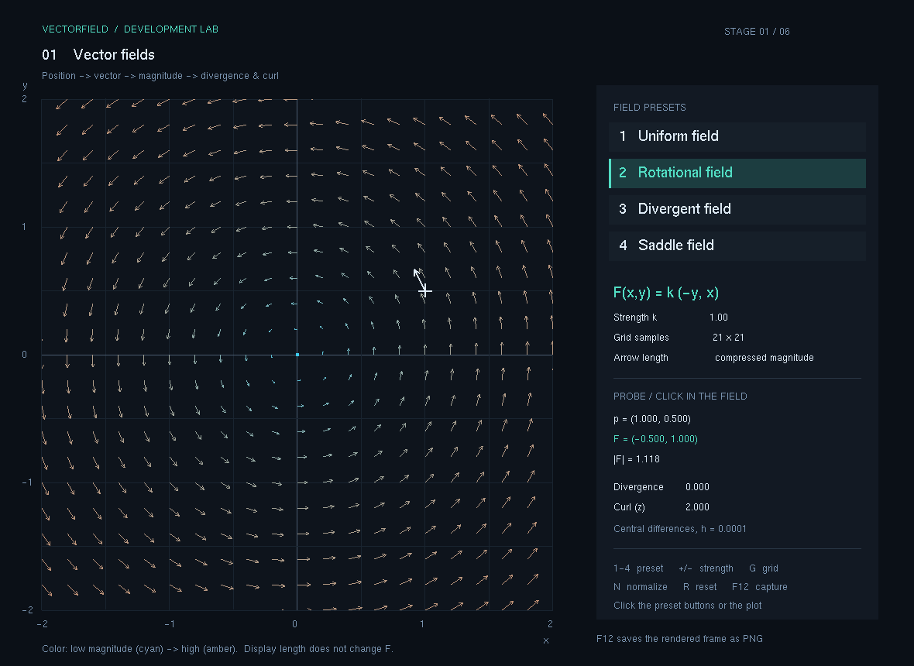
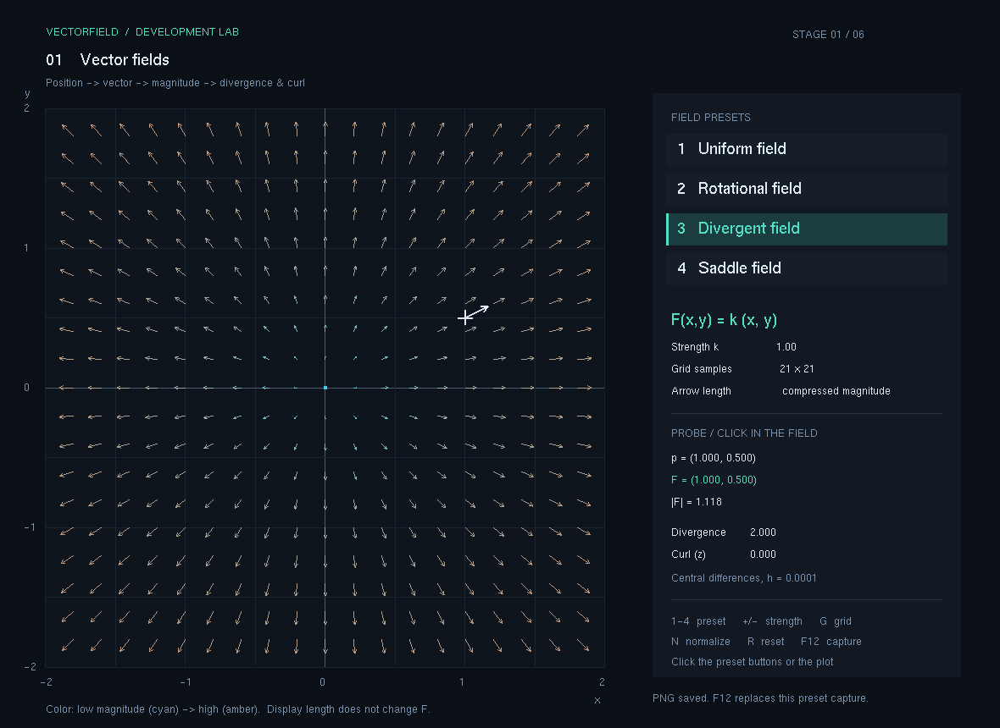
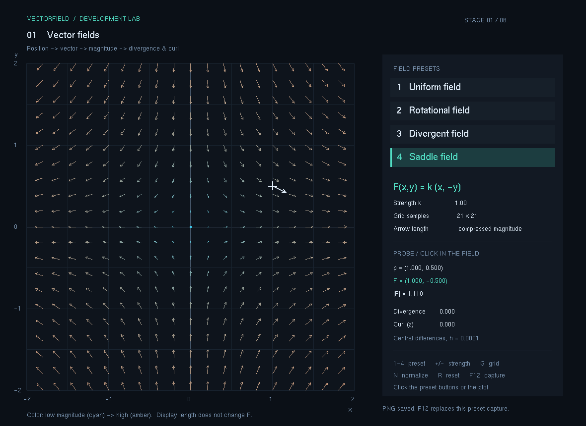
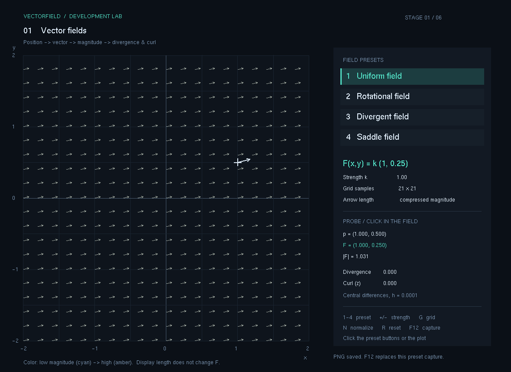

# 1. 벡터장

위치마다 방향과 크기를 갖는 벡터를 계산하고, 이를 화살표로 그리는 단계입니다. 이후 중력장과 유체의 속도장을 다루기 위한 기초를 만듭니다.

현재 상태: **구현·수치 검증·캡처 완료 — 2026-11-09**. x64 Release 빌드와 69개 수학 검사, 네 종류의 PNG를 확인했습니다. 입력별 수동 확인 결과는 아래 표에 구분했습니다.

## 이번 단계의 기능

- 균일장, 회전장, 발산장, 안장장을 실행 중에 전환합니다.
- 같은 좌표에서 벡터의 방향과 크기가 어떻게 달라지는지 비교합니다.
- 강도와 격자 수를 조절하고, 화살표의 길이를 정규화해서 볼 수 있습니다.
- 마우스로 선택한 위치의 좌표, 벡터 성분, 크기, 발산과 회전을 표시합니다.
- 실행 화면을 PNG로 저장합니다.

이 단계에서는 입자를 시간에 따라 움직이지 않습니다. 화면의 화살표는 각 위치에서 계산한 값이며, 입자 이동과 시간 적분은 3단계에서 추가합니다.

## 실행과 조작

이 폴더의 `실행.cmd`를 더블 클릭합니다. 실행 파일은 `실행파일/VectorField.exe`이며, 같은 폴더에 있는 `freeglut.dll`이 필요합니다.

GitHub에서는 `.exe`와 `.dll`을 직접 Git에 넣지 않으므로, 실행하려면 [배포/01_벡터장.zip](../배포/01_벡터장.zip)을 내려받아 압축을 푸세요. 이 ZIP 안에는 실행 파일과 필요한 DLL이 들어 있습니다. 루트의 `run.cmd`는 최신 공통 실행기를 열며, `F1`~`F7` 또는 `Tab`으로 단계를 전환합니다.

| 입력 | 동작 |
| --- | --- |
| `1` | 균일장: $F(x,y)=k(1,0.25)$ |
| `2` | 회전장: $F(x,y)=k(-y,x)$ |
| `3` | 발산장: $F(x,y)=k(x,y)$ |
| `4` | 안장장: $F(x,y)=k(x,-y)$ |
| `+`, `-` | 강도 $k$ 조절: 0.25~3.0 |
| `G` | 격자 수 21×21 → 31×31 → 41×41 |
| `N` | 화살표 길이 정규화 보기 전환 |
| 마우스 클릭 | 선택 위치의 벡터와 미분값 확인 |
| `R` | 초기 설정으로 복원 |
| `F12` | 현재 OpenGL 화면을 PNG로 저장 |

## 어떤 순서로 개발했는가

1. **계산과 그리기를 분리했습니다.** `FieldMath.h`의 `Evaluate()`가 위치와 장 종류를 받아 벡터를 반환합니다. 같은 함수의 결과를 화면 표시와 수치 검증에서 함께 사용합니다.
2. **공간에 표본점을 놓았습니다.** 기본 영역은 $x,y\in[-2,2]$, 표본 수는 각 축 21개입니다. 격자 교점에서 장을 계산하므로 기본 화면에는 441개 표본이 있습니다.
3. **방향과 크기를 화살표로 표현했습니다.** 벡터 방향으로 선분과 화살촉을 그리고, 큰 값의 화살표가 이웃 표본을 가리지 않도록 표시 길이를 압축했습니다. 원래 계산값은 별도로 유지합니다.
4. **선택 지점의 계산값을 표시했습니다.** 클릭 위치를 좌표계로 변환한 뒤 같은 평가 함수에 넣습니다. 크기는 피타고라스 정리로, 발산과 회전은 중앙차분으로 계산합니다.
5. **수치 검증과 화면 확인을 분리했습니다.** 함수의 출력과 알려진 미분값을 먼저 비교하고, 실제 실행 화면에서 방향·길이·조작이 맞는지 확인합니다.

수식, 표본점 배치, 화살표 표시와 계산 예시는 [계산과정.md](계산과정.md)에 정리했습니다.

## 검증 기록

| 항목 | 확인할 내용 | 상태 |
| --- | --- | --- |
| 대표 좌표 | 네 종류의 장이 예상한 벡터를 반환하는가 | 통과 |
| 강도 | 강도 변화가 벡터 성분에 선형으로 반영되는가 | 통과 |
| 원점 | 0벡터에서 0으로 나누거나 NaN이 발생하지 않는가 | 통과 |
| 미분 | 중앙차분의 발산·회전이 이론값과 일치하는가 | 통과 |
| 화면 | 화살표 방향, 모드 전환, 격자·강도 조절이 정상인가 | 통과 |
| 캡처 | 실제 실행 화면의 PNG가 저장되고 열리는가 | 통과 |

자동 검증은 69개 통과, 실패 0개입니다. 실제 출력은 [검증결과.txt](검증결과.txt)에 보관했습니다. GUI에서 G, N, +, R, 원점 클릭과 네 종류 전환도 확인했습니다.

| 수동 입력 | 확인 결과 |
| --- | --- |
| `1`~`4` | 네 종류의 장으로 전환됨 |
| `G` | 격자 수가 바뀌고 화살표가 다시 배치됨 |
| `N` | 화살표의 길이 표시 방식이 바뀜 |
| `=` (`+`와 같은 증가 입력) | 강도가 증가하고 벡터 값이 갱신됨 |
| `R` | 초기 설정으로 돌아옴 |
| 원점 클릭 | 선택점과 0벡터 정보가 유한한 값으로 표시됨 |
| `F12` | 실제 OpenGL 프레임이 PNG로 저장됨 |

## 실행 화면

다음 이미지는 실제 실행 중 F12로 OpenGL 프레임버퍼를 저장한 PNG입니다. 창 테두리와 마우스 커서를 제외한 프로그램 화면이며, 모두 k=1, 21×21 격자, 선택점 (1, 0.5)로 기록했습니다.

### 01. 회전장

원점 주위를 반시계 방향으로 도는 장입니다. 원점에서 멀어질수록 벡터 크기가 커집니다.

### 02. 발산장

원점에서 바깥쪽으로 퍼집니다. 이 장의 발산은 모든 위치에서 $2k$입니다.

### 03. 안장장

x축 방향으로는 바깥쪽, y축 방향으로는 원점을 향합니다. 발산과 회전이 모두 0이어도 장 자체가 0이라는 뜻은 아닙니다.

### 04. 균일장

모든 위치에 같은 벡터를 배치합니다. 격자의 위치가 바뀌어도 방향과 크기는 같습니다.

## 보관 파일

| 경로 | 내용 |
| --- | --- |
| `실행.cmd` | 이 단계 실행 |
| `실행파일/` | 실행 파일과 필요한 DLL |
| `소스/` | 압축하지 않은 1단계 전체 프로젝트와 빌드 스크립트 |
| `캡처/` | 실제 실행 화면 PNG |
| `계산과정.md` | 사용한 수식과 계산 예시 |
| `검증결과.txt` | 자동 검증 실행 결과 |

1단계 소스는 `소스/` 안에 프로젝트 트리 그대로 보관했습니다. 그 안의 `build.cmd`로 해당 시점을 다시 빌드할 수 있습니다. 공통 프로젝트의 최신 소스는 루트의 `opgnel_project_smoke`에서 이어서 개발합니다. 공통 실행기에서 단계를 바꾼 뒤 저장하는 캡처는 `captures/stage-01/`처럼 단계별 폴더로 나뉩니다. 다음 단계는 [2. 중력장](../2.중력장/README.md)입니다.

이론 참고: [OpenStax, Calculus Volume 3 — Vector Fields](https://openstax.org/books/calculus-volume-3/pages/6-1-vector-fields). 벡터장의 정의와 시각화 설명을 참고했으며, 실행 코드는 이 프로젝트에서 구현합니다.
