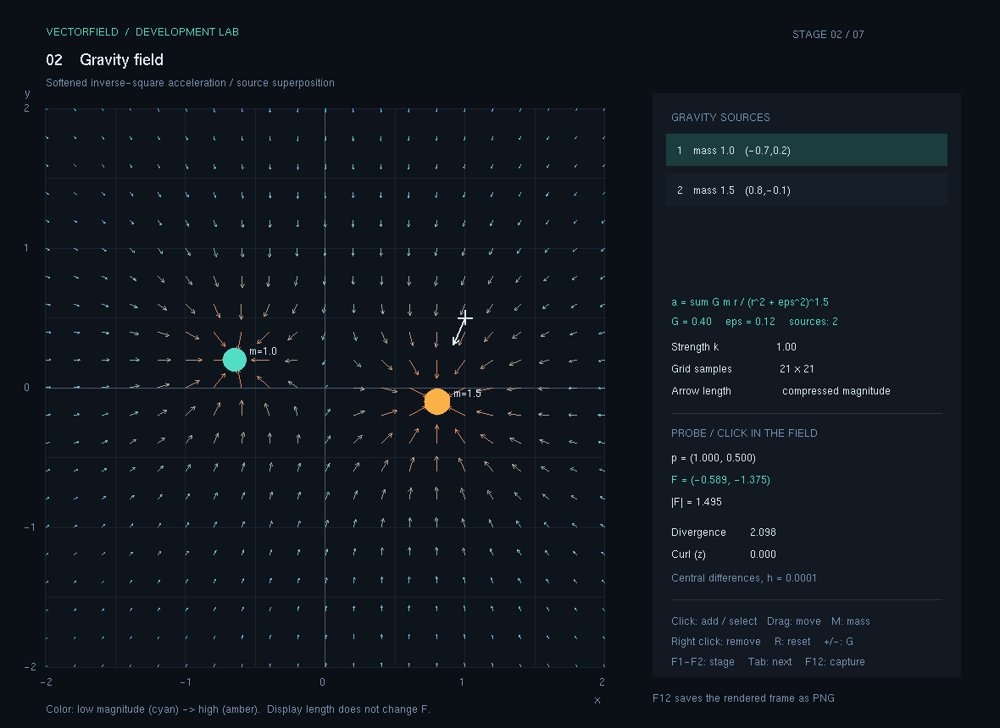
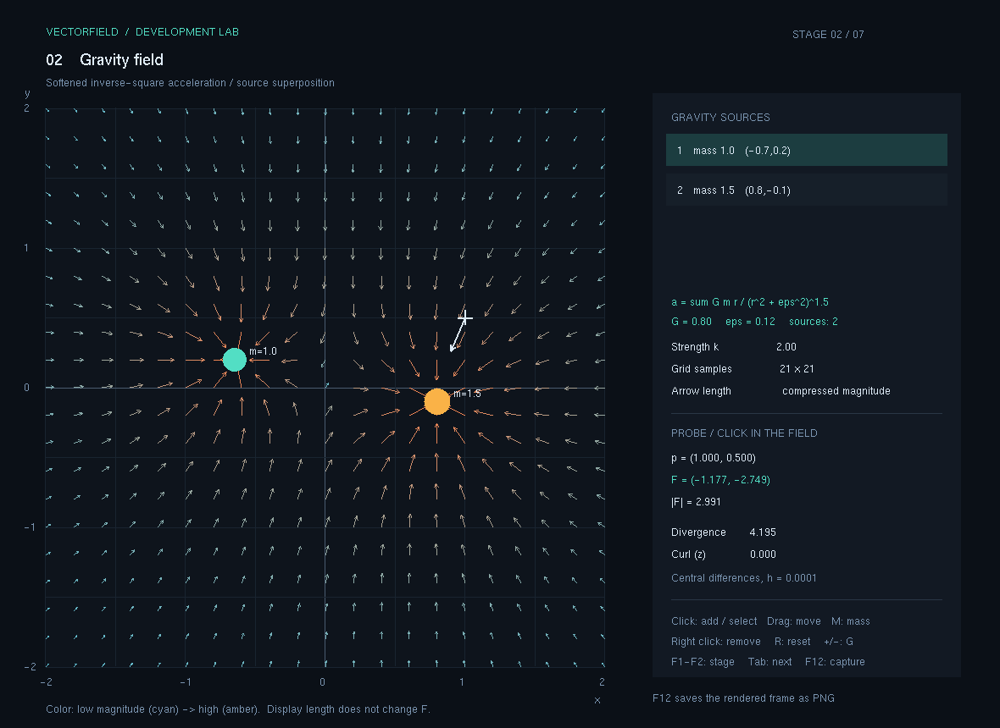

# 2. 중력장

1단계에서 위치마다 벡터를 계산했다면, 이번에는 여러 중력원의 위치와 질량으로 중력 가속도장을 만듭니다. 각 중력원이 만드는 벡터를 더하고, 중심 근처에서도 계산값이 유한하도록 완화 길이를 적용합니다.

현재 상태: **구현·수치 검증·캡처 완료 — 2026-11-09**. 단계 실행 파일과 실제 PNG 두 장을 보관했습니다. 입력별 수동 확인 결과는 아래 표에 구분합니다.

## 이번 단계의 기능

- 중력원 여러 개가 만드는 합성 가속도장을 격자 화살표와 크기 색상으로 표시합니다.
- 중력원을 추가·삭제·이동하고 선택한 중력원의 질량을 바꿉니다.
- 중력원의 중심에서도 0으로 나누지 않도록 완화한 역제곱 법칙을 사용합니다.
- 같은 설정을 다시 평가해도 이전 결과가 누적되지 않도록 계산을 순수 함수로 분리했습니다.

기본 중력원은 두 개입니다. 좌표와 질량은 시각화용 무차원 값이며, G=0.4를 실제 SI 중력상수로 해석하지 않습니다.

| 중력원 | 위치 | 질량 |
| --- | --- | --- |
| A | (-0.65, 0.20) | 1.0 |
| B | (0.80, -0.10) | 1.5 |

공통 설정은 G=0.4, 완화 길이 ε=0.12입니다.

## 실행과 조작

이 폴더의 `실행.cmd`를 더블 클릭합니다. `실행파일/VectorField.exe`와 같은 폴더의 `freeglut.dll`이 함께 필요합니다. 루트의 `run.cmd`로 여는 최신 공통 실행기에서는 `F2`로 이동하며, `F1`~`F7` 또는 `Tab`으로 단계를 전환합니다.

GitHub에서는 `.exe`와 `.dll`을 직접 Git에 넣지 않으므로, 실행하려면 [배포/02_중력장.zip](../배포/02_중력장.zip)을 내려받아 압축을 푸세요. 이 ZIP 안에는 실행 파일과 필요한 DLL이 들어 있습니다.

| 입력 | 동작 |
| --- | --- |
| F2 | 중력장 단계 선택 |
| Tab | 다음 단계 선택 |
| 빈 위치에서 왼쪽 클릭 | 중력원 추가 |
| 중력원을 왼쪽으로 드래그 | 해당 중력원 이동 |
| 중력원 근처에서 오른쪽 클릭 | 중력원 삭제 |
| M | 선택한 중력원의 질량을 0.5 증가, 4.0 다음에는 0.5로 순환 |
| +, - | 장의 전체 강도 조절 |
| G | 화살표 표본 격자 수 변경 |
| N | 화살표 길이 정규화 표시 전환 |
| R | 기본 중력원과 설정으로 초기화 |
| F12 | 실제 OpenGL 화면을 PNG로 저장 |

위 표는 구현된 조작법입니다. 개별 입력을 직접 눌러 확인한 결과는 아래 수동 확인표에 남깁니다.

## 어떤 순서로 개발했는가

1. **중력원을 데이터로 정의했습니다.** DynamicsMath.h의 GravitySource는 위치 Vec2와 질량을 저장합니다. 화면 그리기나 입력 상태를 계산 함수에 넣지 않습니다.
2. **중력장 평가 함수를 만들었습니다.** GravityField()는 관찰점에서 각 중력원으로 향하는 상대벡터를 구해 가속도 기여분을 계산합니다. 관찰 입자의 질량은 가속도 식에서 약분됩니다.
3. **역제곱 법칙에 완화를 추가했습니다.** 거리의 제곱에 ε²을 더해 중심 특이점을 없앴습니다. 중심에서 자기 자신에 해당하는 기여분은 정확히 0으로 처리합니다.
4. **이전 프레임과 독립적으로 합산했습니다.** 매 호출마다 합계를 0에서 시작합니다. 상쇄가 큰 항을 더할 때는 보상합산으로 반올림 오차를 줄입니다.
5. **기존 Planet 계산의 문제를 검증에 연결했습니다.** 거리 감쇠, 중첩, 입력 순서, 반복 평가, 중심 유한성 등을 각각 자동 검사로 확인했습니다.
6. **공통 앱의 입력과 연결했습니다.** 중력원 배열이 바뀌면 같은 GravityField()를 다시 평가해 화면을 갱신합니다. 실제 실행 결과를 PNG로 남겼습니다.

수식 유도와 숫자 대입, 기존 코드와의 차이는 [계산과정.md](계산과정.md)에 적었습니다.

## 검증 기록

| 항목 | 확인 내용 | 상태 |
| --- | --- | --- |
| 빈 장·중심 | 중력원이 없거나 중심에 있어도 유한한 값을 반환 | 통과 |
| 방향·대칭 | 중력원 쪽을 향하고 대칭 위치의 결과가 대칭 | 통과 |
| 거리 감쇠 | ε가 충분히 작으면 거리 2배에서 크기가 약 1/4 | 통과 |
| 선형성 | 질량과 G 변화에 가속도가 비례 | 통과 |
| 중첩 | 개별 중력장의 합과 합성장이 일치 | 통과 |
| 순서·반복 | 소스 순서 변경과 반복 호출이 이전 결과를 누적하지 않음 | 통과 |
| 입력 범위 | 0인 완화 길이와 비유한 입력을 거부 | 코어의 완화 길이 검사 통과 |
| 단계 실행·캡처 | 실제 PNG 2장 생성과 파일 열기 | 통과 |

이 단계 보관본의 누적 자동 검증은 **111개 통과, 실패 0개**입니다. 벡터 수학 69개와 Dynamics 42개를 한 번씩 실행한 결과이며, 실제 출력은 [검증결과.txt](검증결과.txt)에 있습니다. Dynamics 42개에는 2단계 중력장과 3단계 RK2 검사가 함께 들어 있습니다. 단계별 누계를 서로 더해 새로운 검사 수로 세지 않습니다.

| 수동 입력 | 실제 확인 결과 |
| --- | --- |
| 빈 곳 왼쪽 클릭 | 중력원 수가 2개에서 3개로 증가하고 장이 바뀜 |
| 중력원 드래그 | 위치가 약 (0.091, 1.145)에서 (0.697, 1.448)로 이동하고 장이 갱신됨 |
| `M` | 선택 중력원의 질량이 1.0에서 1.5로 증가함 |
| 중력원 근처 오른쪽 클릭 | 중력원 수가 3개에서 2개로 줄고 장이 갱신됨 |
| `F2` 단계 전환 후 `F12` | PNG 저장 안내와 `captures/stage-02/01_중력합성.png` 생성·열기 확인 |

수동 입력 확인 범위는 위 항목입니다.

## 실행 화면

다음은 실제 프로그램에서 저장하고 열어 확인한 OpenGL 프레임입니다. 두 장 모두 21×21 격자, 선택점 (1, 0.5), 기본 중력원 두 개를 사용합니다.

### 01. 중력원 두 개의 합성

강도 k=1, 유효 G=0.4, ε=0.12에서 격자마다 계산한 합성 가속도입니다. 중력원 A와 B의 질량은 1.0과 1.5이며, 기여분이 반대 방향일 때는 일부 상쇄됩니다.

### 02. 중력장의 강도 분포

같은 중력원에서 강도를 k=2로 높인 화면입니다. 유효 G는 0.8이며, 선택점 가속도 크기는 첫 화면의 약 1.495에서 약 2.991로 커집니다. 화면의 화살표 길이는 겹침을 줄이도록 압축해서 표시합니다.

## 보관 파일과 다음 단계

| 경로 | 내용 |
| --- | --- |
| 실행.cmd | 2단계 선택 실행 |
| 실행파일/ | VectorField.exe와 freeglut.dll |
| 소스/전체소스.zip | 이 단계 실행기를 다시 빌드할 수 있는 전체 프로젝트 |
| 소스/의 헤더·cpp | 압축을 풀지 않고 읽을 수 있는 주요 계산·화면 소스 |
| 계산과정.md | 가속도장 수식, 완화·합산·기존 코드 수정 설명 |
| 검증결과.txt | 실제 자동 검증 출력 |
| 캡처/ | 실제 프로그램 화면 PNG |

공통 수학 소스는 `opgnel_project_smoke/DynamicsMath.h`, 검증 코드는 `tests/DynamicsTests.h`입니다. 화면·입력 연결은 `FieldLab.cpp`에서 담당합니다. 해당 시점을 다시 빌드하려면 `소스/전체소스.zip`을 별도 폴더에 풀고 그 안의 `build.cmd`를 실행합니다. 최신 공통 앱은 저장소 루트의 `build.cmd`로 빌드합니다. 공통 실행기에서 단계 전환 후 저장하는 캡처는 `captures/stage-02/`처럼 단계별로 나뉩니다.

다음 [3.입자이동](../3.입자이동/README.md)에서는 정해진 속도장을 따라 추적 입자를 움직입니다. 중력 가속도를 곧바로 속도로 취급해 행성 궤도라고 설명하지 않습니다. 최종 목표에는 기체 유체뿐 아니라 물 입자도 포함하며, 두 매체의 상호작용은 이후 단계로 남깁니다.
