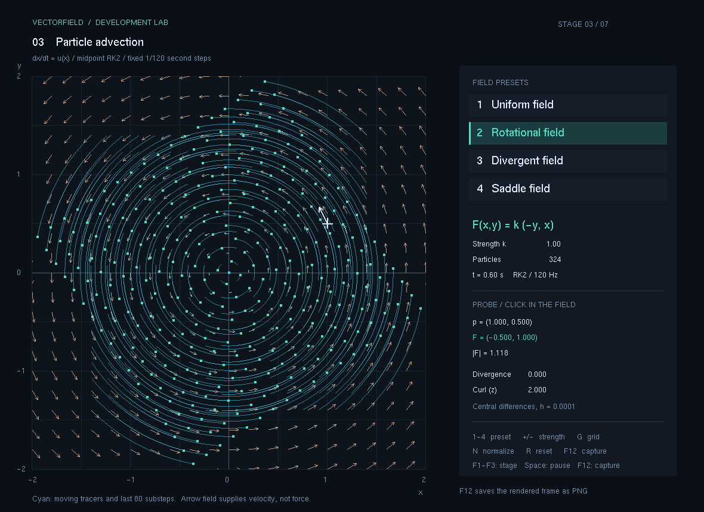
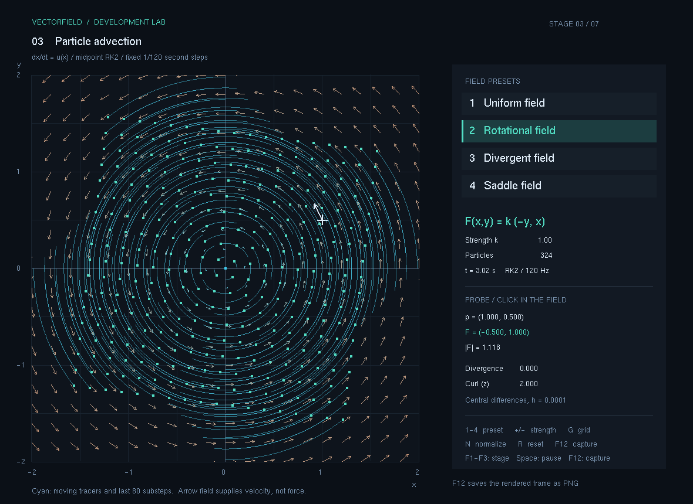

# 3. 입자이동

벡터장의 화살표를 보는 단계에서 시간에 따라 입자가 움직이는 단계로 넘어갑니다. 각 위치에서 계산한 벡터를 속도로 해석하고, 같은 속도장 안의 추적 입자를 RK2 방법으로 이동시킵니다.

현재 상태: **구현·수치 검증·캡처 완료 — 2026-11-09**. 단계 실행 파일과 실제 PNG 두 장을 보관했습니다. 실제 실행으로 확인한 범위는 아래 표에 구분합니다.

## 이번 단계의 기능

- 1단계의 균일장·회전장·발산장·안장장을 속도장으로 사용합니다.
- 기본 324개 추적 입자를 고정 시간 간격으로 이동시킵니다.
- 입자마다 최근 위치를 최대 80개 남겨 이동 방향과 궤적을 그립니다.
- 일시정지·초기화와 속도장 전환으로 같은 설정을 다시 관찰합니다.
- 경과 시간에 따른 실제 화면을 PNG로 남깁니다.

추적 입자는 흐름을 보기 위한 표지입니다. 입자끼리 힘을 주고받거나 압력·점성·충돌을 계산하지 않습니다. 이번 단계의 고정 속도장은 이후 유체 솔버가 스스로 계산하는 속도장과 구분합니다.

## 실행과 조작

이 폴더의 `실행.cmd`를 더블 클릭합니다. `실행파일/VectorField.exe`와 같은 폴더의 `freeglut.dll`이 함께 필요합니다. 루트의 `run.cmd`로 여는 최신 공통 실행기에서는 `F3`로 이동하며, `F1`~`F7` 또는 `Tab`으로 단계를 전환합니다.

GitHub에서는 `.exe`와 `.dll`을 직접 Git에 넣지 않으므로, 실행하려면 [배포/03_입자이동.zip](../배포/03_입자이동.zip)을 내려받아 압축을 푸세요. 이 ZIP 안에는 실행 파일과 필요한 DLL이 들어 있습니다.

| 입력 | 동작 |
| --- | --- |
| F3 | 입자이동 단계 선택 |
| Tab | 다음 단계 선택 |
| 1 | 균일 속도장 u=(1,0.25) |
| 2 | 회전 속도장 u=(-y,x) |
| 3 | 발산 속도장 u=(x,y) |
| 4 | 안장 속도장 u=(x,-y) |
| Space | 시간 진행 일시정지·재개 |
| R | 입자 위치·궤적·경과 시간을 초기화 |
| F12 | 실제 OpenGL 화면을 PNG로 저장 |

기본 속도장은 회전장, 계산 간격은 Δt=1/120초입니다. 초기 입자는 각 축 [-1.4, 1.4]에 같은 간격으로 18개씩 배치한 18×18, 총 324개입니다.

## 어떤 순서로 개발했는가

1. **속도 함수와 입자 상태를 나눴습니다.** Evaluate()는 위치의 속도를 반환하고, 입자에는 현재 위치와 최근 궤적을 저장합니다.
2. **시간 변화의 식을 정했습니다.** dx/dt=u(x)를 적분합니다. 위치를 한 번에 크게 이동시키지 않고 고정된 작은 시간 간격으로 갱신합니다.
3. **중점 RK2 적분을 구현했습니다.** 현재 위치에서 속도를 구해 반 시간 뒤의 위치를 예측하고, 그 중점에서 다시 구한 속도로 전체 시간 간격을 이동합니다.
4. **렌더링과 계산 간격을 분리했습니다.** 화면을 한 번 그리는 동안 지난 시간을 모아 필요한 수의 1/120 간격을 계산합니다. 화면 프레임 수를 그대로 시뮬레이션의 시간으로 사용하지 않습니다.
5. **짧은 궤적을 보관했습니다.** 최대 80개의 최근 위치를 연결해 순간 위치만으로 읽기 어려운 회전 방향과 흐름을 표시합니다. 80개를 넘는 전체 경로를 계속 쌓지는 않습니다.
6. **알려진 해로 오차를 측정했습니다.** 균일장에서는 정확한 이동량과 비교하고, 회전장에서는 원 궤도의 반지름과 시간별 위치를 비교했습니다.

RK2의 수식과 1회 계산 예시는 [계산과정.md](계산과정.md)에 적었습니다.

## 검증 기록

자동 검사 중 회전 비교는 UI의 1/120 간격과 별도로 **Δt=0.01, 1,000스텝, 총 10초** 조건을 사용했습니다. 초기 위치는 (1,0), 속도장은 u=(-y,x)입니다.

| 수치 | RK2 | 명시적 Euler 비교값 |
| --- | --- | --- |
| 10초 뒤 반지름 오차 | 1.25×10⁻⁶ | 0.0512685 |
| 10초 뒤 위치 오차 | 0.000166666 | 0.0512696 |

위치 오차는 해석해 (cos 10, sin 10)와 계산 위치의 유클리드 거리입니다. 화면을 보고 추정한 값이 아니라 실제 C++ 계산에서 출력한 값입니다.

| 항목 | 확인 내용 | 상태 |
| --- | --- | --- |
| 균일장 | 속도×시간만큼 정확히 이동 | 통과 |
| 0인 속도·시간 | 위치 유지, 0인 시간 간격에서는 속도 평가도 생략 | 통과 |
| 회전장 | 반지름 오차 2×10⁻⁶ 미만, 위치 오차 2×10⁻⁴ 미만 | 통과 |
| 시간 간격 | 발산장에서 Δt를 절반으로 줄이면 오차가 감소 | 통과 |
| 잘못된 입력 | 비유한 시간 간격과 비유한 속도를 거부 | 통과 |
| 시간 진행·캡처 | 실제 계산 시간 진행, 두 시점 PNG 생성·열기 | 통과 |

이 단계 보관본의 누적 자동 검증은 **111개 통과, 실패 0개**입니다. 벡터 수학 69개와 Dynamics 42개를 한 번씩 실행한 결과이며, 실제 출력은 [검증결과.txt](검증결과.txt)에 있습니다. Dynamics에는 2단계 중력장과 3단계 RK2 검사가 함께 들어 있으므로, 각 단계의 누계를 다시 합산하지 않습니다.

| 실행 확인 범위 | 실제 확인 결과 |
| --- | --- |
| 기본 회전장 시간 진행 | 실제 실행에서 입자 위치와 궤적이 변화함 |
| 두 시점 프레임 저장 | 약 0.6초와 약 3초의 PNG 생성·열기 확인 |

이 단계의 실제 실행 확인은 기본 회전장의 자동 시간 진행과 두 시점 프레임 저장 조건에서 수행했습니다.

## 실행 화면

아래 이미지는 실제 실행 화면에서 저장하고 열어 확인한 PNG입니다. 두 장 모두 기본 회전장 u=(-y,x), 강도 1, 추적 입자 324개, 고정 1/120초 간격을 사용했습니다. 정확한 경과 시간은 각 이미지의 HUD에 표시되어 있습니다.

### 01. 이동 시작 후 약 0.6초

기본 회전 속도장에서 초기 위치를 떠난 입자와 최근 궤적을 관찰합니다.

### 02. 이동 시작 후 약 3초

동일한 초기 설정에서 시간이 더 흐른 화면입니다. 궤적은 입자별 최대 80개의 최근 위치를 표시하므로, 3초 동안의 전체 이동 경로를 모두 보관했다는 뜻은 아닙니다.

## 보관 파일과 다음 단계

| 경로 | 내용 |
| --- | --- |
| 실행.cmd | 3단계 선택 실행 |
| 실행파일/ | VectorField.exe와 freeglut.dll |
| 소스/전체소스.zip | 이 단계 실행기를 다시 빌드할 수 있는 전체 프로젝트 |
| 소스/의 헤더·cpp | 압축을 풀지 않고 읽을 수 있는 주요 계산·화면 소스 |
| 계산과정.md | 이류 방정식, RK2, 고정 시간 간격과 오차 설명 |
| 검증결과.txt | 실제 자동 검증과 회전 오차 출력 |
| 캡처/ | 두 시점의 실제 프로그램 화면 PNG |

공통 수학 소스는 `DynamicsMath.h`의 `AdvectRK2()`, `FieldMath.h`의 `Evaluate()`이며, 검증 코드는 `tests/DynamicsTests.h`입니다. `FieldLab.cpp`가 입자 상태·시간 진행·궤적·입력을 연결합니다. 해당 시점을 다시 빌드하려면 `소스/전체소스.zip`을 별도 폴더에 풀고 그 안의 `build.cmd`를 실행합니다. 최신 공통 앱은 저장소 루트의 `build.cmd`로 빌드합니다. 공통 실행기에서 단계 전환 후 저장하는 캡처는 `captures/stage-03/`처럼 단계별로 나뉩니다.

다음 [4단계](../4.이류와확산/README.md)는 격자에 저장한 염료의 이류·확산입니다. 이후 속도와 압력을 함께 풀어 기체 유체를 만들고, [7단계](../7.물입자/README.md)에서는 물 입자로 범위를 넓혔습니다. 기체와 물을 서로 밀고 당기게 하는 두 매체 상호작용은 후속 과제입니다.
