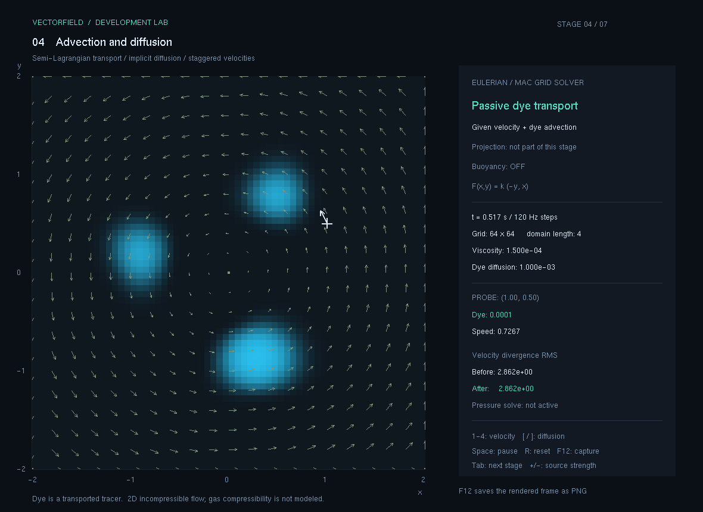
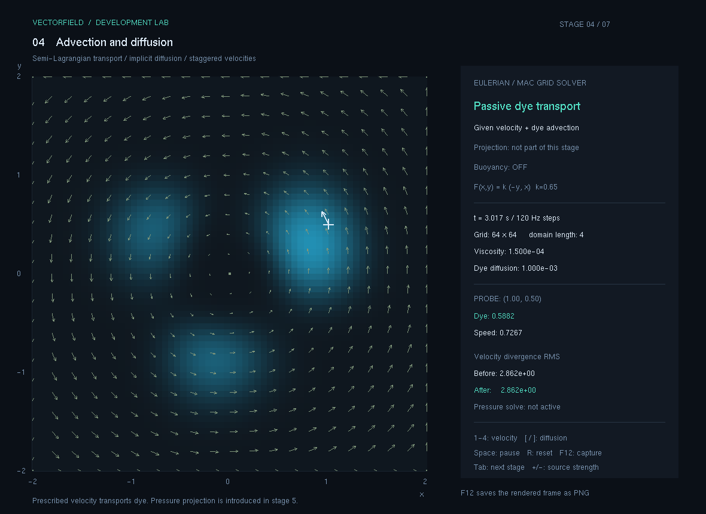

# 4. 이류와 확산

격자의 염료를 주어진 속도장으로 옮기고 확산시키는 단계입니다. 3단계에서 입자의 위치를 따라갔다면, 여기서는 고정된 셀에 저장한 농도가 시간에 따라 어떻게 바뀌는지 봅니다.

현재 상태: **구현·수치 검증·실행 화면 캡처 완료**. 입력별 수동 확인 결과는 최종 확인표에 따르며, 자동 검증과 캡처만으로 모든 입력의 확인을 대신하지 않습니다.

## 이번 단계의 기능

- `64×64` 격자에 단일 염료의 농도를 저장하고 색의 밝기로 표시합니다.
- 균일장·회전장·발산장·안장장으로 염료 이동을 비교합니다.
- 같은 속도장에서 확산 계수를 바꾸어 퍼지는 정도를 관찰합니다.
- 마우스로 염료를 추가하며, 입력이 주어진 속도장을 바꾸지는 않습니다.
- 시간, 격자 크기, 확산 계수, 선택한 셀의 농도와 속력을 표시합니다.

계산 영역은 `[-2,2]²`, 격자 간격은 `4/64=0.0625`입니다. 시뮬레이션은 렌더링과 분리한 고정 `1/120초` 간격으로 진행합니다. 초기 장은 강도0.65의 회전장이며, 서로 다른 세 위치에 같은 종류의 염료 덩어리를 놓습니다. 세 가지 물질이나 색별 성분을 계산하는 모델은 아닙니다.

## 실행과 조작

이 폴더의 `실행.cmd`를 더블 클릭합니다. 단계별 실행 파일은 `실행파일/VectorField.exe`이며 `freeglut.dll`과 함께 둡니다. 공통 실행기에서는 `F4`로 이 단계로 이동합니다.

GitHub에서 실행용 파일을 받을 때는 [배포/04_이류와확산.zip](../배포/04_이류와확산.zip)을 다운로드하여 압축을 풀고 `실행.cmd`를 실행하세요. EXE와 DLL은 개별 파일로 Git에 올리지 않으며 배포 ZIP 안에 포함합니다. 최신 공통 앱은 루트의 `run.cmd`로 실행하고 `F1`~`F7` 또는 `Tab`으로 전환합니다.

| 입력 | 동작 |
| --- | --- |
| `1`~`4` | 균일장·회전장·발산장·안장장 선택 |
| `+`, `-` | 속도장 강도 조절 |
| `[` / `]` | 확산 계수를 절반 / 두 배로 조절 |
| 왼쪽 버튼을 누른 채 드래그 | 염료 주입 |
| `Space` | 일시정지 / 재개 |
| `R` | 초기 염료와 장으로 복원 |
| `Tab`, `F1`~`F7` | 단계 전환 |
| `F12` | 현재 프레임을 PNG로 저장 |

4단계의 기본 염료 확산 계수는 `0.001 길이²/초`입니다. 소스 코드의 `StepDye` 기본 인수값 `0.00002`와 달리, 단계 실행기에서 퍼짐이 관찰되도록 `0.001`을 전달합니다. 값을 바꿀 때는 화면의 현재 계수를 함께 확인하세요. 이 단계에서는 속도 점성을 계산하지 않습니다. 보관 실행본과 아래 캡처의 `Viscosity: 1.500e-04`는 공통 설정값 표시일 뿐, 4단계에서 적용한 계수가 아닙니다.

## 어떤 순서로 개발했는가

1. **입자 대신 격자 농도를 저장했습니다.** 각 셀 중심의 염료와 셀 면의 속도를 구분했습니다. 이 배치는 다음 단계의 압력 투영에도 그대로 사용합니다.
2. **확산을 먼저 풀었습니다.** 후진 오일러 방식으로 이웃 농도가 퍼지는 식을 만들고 Gauss–Seidel 24회로 근사합니다.
3. **염료의 출발점을 역추적했습니다.** 현재 셀에서 속도의 반대 방향으로 한 시간 간격 돌아가 이전 농도를 읽습니다.
4. **셀 사이 값을 보간했습니다.** 역추적 위치 주변 네 셀의 농도를 쌍선형 보간합니다. 영역 밖은 벽으로 제한합니다.
5. **이론값과 비교했습니다.** 상수 농도 유지, 선형장 보간, 균일 속도에서의 이동량, 확산 후 최고 농도 감소를 검사했습니다.

구체적인 배열 위치, 단위, 반복식과 숫자 예시는 [계산과정.md](계산과정.md)에 정리했습니다.

## 검증 기록

단계 보관본의 누적 자동 검사는 **132개 통과, 실패0개**입니다. 벡터69개, 동역학42개, 유체21개를 합한 수이며, 아래 결과는 그중 유체 검사에 포함됩니다.

| 항목 | 실제 결과 |
| --- | --- |
| 상수 농도 | 농도0.75가 확산과 이류 후에도 유지됨, 허용 오차 `1e-9` |
| 선형장 보간 | 회전장 속도의 해석적 값과 `1e-9` 이내 일치 |
| 균일장 이동 | 속도 `(1,0.25)`로1초 이류한 정규화 무게중심 이동 `(0.25,0.0625)` |
| 확산 | 48² 격자, 확산 계수0.04에서 최고 농도 `2.999742804 → 1.055901638` |
| 벽 조건 | 법선 속도0, 염료의 벽 법선 기울기0 |
| PNG | 실제 프레임버퍼 화면2장 저장·열람 확인 |

독립 검사는 UI 기본값과 구분된 조건으로 수행했습니다. 전체 출력은 [검증결과.txt](검증결과.txt)에 있습니다. 입력별 수동 조작의 확인 상태는 별도 기록을 따릅니다. 이류는 수치 확산을 만들고 염료 총량을 정확히 보존하지 않습니다. 물리적 확산 계수가0이어도 염료의 날카로운 경계가 흐려질 수 있습니다.

## 실행 화면 기록

다음 이미지는 실제 OpenGL 프레임버퍼를 저장한 화면입니다. 회전장 강도0.65, 격자64², 염료 확산 계수0.001을 사용했습니다. 시점은 화면 HUD를 기준으로 대략 표시했습니다.

| 파일 | 기록 조건과 관찰할 내용 |
| --- | --- |
| `캡처/01_이류.png` | 초기 회전장, 약0.5초, 세 염료 덩어리의 이동 |
| `캡처/02_확산.png` | 같은 설정으로 약3초, 염료 경계의 퍼짐과 혼합 |

약0.5초: 세 염료 덩어리가 주어진 회전장에 따라 이동합니다.

약3초: 같은 설정으로 더 진행한 결과이며, 지정한 확산과 이류 보간의 수치 확산이 함께 보입니다.

두 화면의 차이에는 지정한 확산과 이류 보간의 수치 확산이 함께 포함됩니다.

## 보관 파일과 다음 단계

`실행.cmd`, `실행파일/`, [소스/전체소스.zip](소스/전체소스.zip), `검증결과.txt`, `캡처/`에 단계별 실행·소스·검증 자료를 보관합니다. 소스 ZIP은 별도 폴더에 풀고 `build.cmd`로 다시 빌드할 수 있습니다. 연산 설명은 이 폴더의 `계산과정.md`입니다. 공통 소스는 [`FluidGrid.h`](../opgnel_project_smoke/FluidGrid.h), 테스트는 [`FluidGridTests.h`](../tests/FluidGridTests.h)에 있습니다. 최신 공통 앱에서 단계를 전환한 뒤 저장한 캡처는 `captures/stage-04/`에 모입니다.

다음 [5. 비압축 유체](../5.비압축유체/README.md)에서는 주어진 속도장을 그대로 쓰는 대신, 속도를 이류하고 압력으로 발산을 줄입니다.
