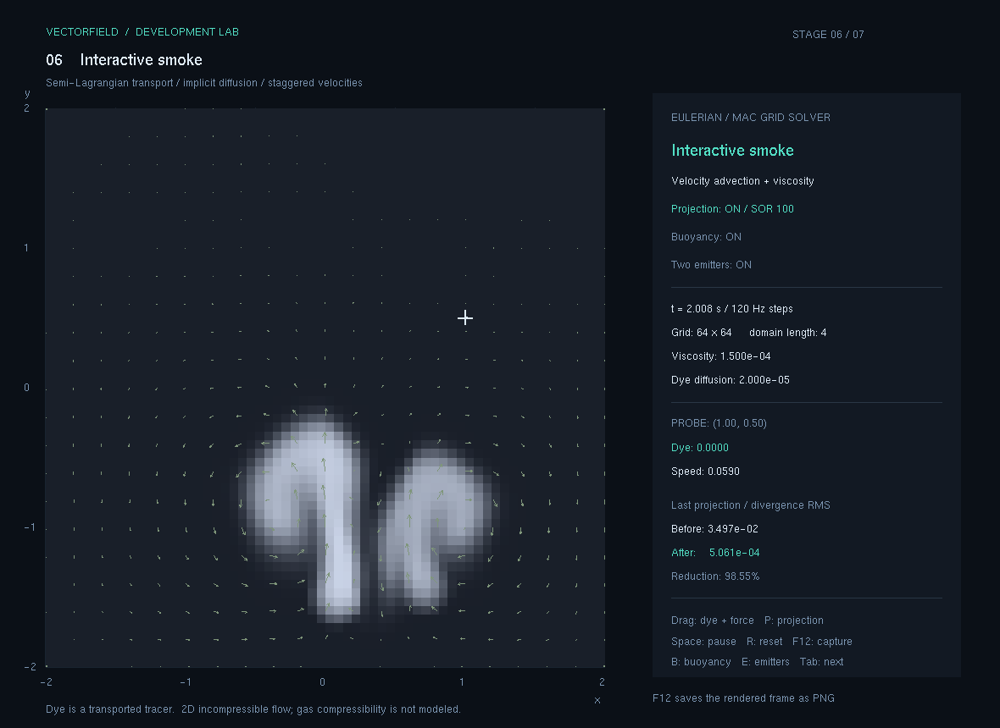
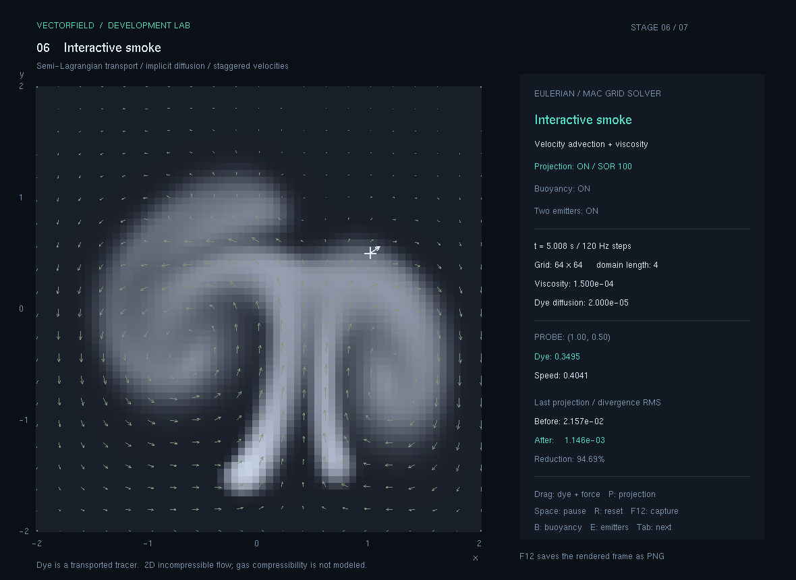

# 6. 상호작용 기체

두 노즐에서 연기를 계속 넣고, 부력과 마우스 입력으로 흐름을 만드는 기체 단계입니다. 염료 주입, 외력, 이류, 점성, 압력 투영을 하나의 반복 계산에 연결합니다.

현재 상태: **구현·수치 검증·실행 화면 캡처 완료**. 실제 실행과 수동 확인 범위는 아래에 기록했습니다.

## 이번 단계의 기능

- 서로 다른 위치와 시간 변화 입력을 가진 두 연속 노즐을 사용합니다.
- 염료 농도에 따른 위쪽 부력을 켜고 끌 수 있습니다.
- 드래그로 연기를 추가하고 흐름을 밀어 기존 분출과 상호작용시킵니다.
- 노즐을 끈 뒤 남은 염료와 속도장의 변화를 관찰할 수 있습니다.
- 시간·격자·점성·확산 계수와 압력 투영의 발산 감소를 표시합니다.

모델은 `64×64` MAC 격자, 영역 `[-2,2]²`, 고정 `1/120초` 간격을 사용하는 2차원 비압축 연기입니다. 별도의 온도장·압축성·연소 반응은 계산하지 않습니다. 물은 [7단계](../7.물입자/README.md)에서 별도로 다루며, 현재 기체와 물을 서로 결합하는 계산은 구현하지 않습니다.

## 실행과 조작

이 폴더의 `실행.cmd`를 더블 클릭합니다. 단계별 실행 파일은 `실행파일/VectorField.exe`이며 같은 폴더의 `freeglut.dll`이 필요합니다. 공통 실행기에서는 `F6`으로 이동합니다.

GitHub에서는 [배포/06_상호작용기체.zip](../배포/06_상호작용기체.zip)을 다운로드해 압축을 풀고 `실행.cmd`를 실행하세요. EXE와 DLL은 개별 Git 파일에서 제외되며 배포 ZIP 안에 포함합니다. 최신 공통 앱은 루트의 `run.cmd`로 실행하고 `F1`~`F7` 또는 `Tab`으로 전환합니다.

| 입력 | 동작 |
| --- | --- |
| 왼쪽 버튼을 누른 채 드래그 | 염료 주입과 드래그 방향의 속도 증분 입력 |
| `B` | 부력 켜기 / 끄기, 기본 켬 |
| `E` | 연속 노즐 켜기 / 끄기 |
| `P` | 압력 투영 켜기 / 끄기 |
| `+`, `-` | 입력 강도 조절 |
| `Space` | 일시정지 / 재개 |
| `R` | 염료·속도·시간을 초기화 |
| `Tab`, `F1`~`F7` | 단계 전환 |
| `F12` | 현재 프레임을 PNG로 저장 |

초기화하면 계산 영역을 비우고 노즐에서 다시 분출을 시작합니다. 벽은 위쪽까지 닫혀 있으므로 연기가 경계 밖으로 빠져나가지는 않습니다. 오래 주입하면 영역 안에 염료가 쌓일 수 있습니다.

## 노즐과 입력의 실제 설정

노즐 좌표와 반경은 `[0,1]²` 정규화 영역 기준입니다. `t`는 시뮬레이션 초, `dt`는 고정 시간 간격입니다.

| 요소 | 첫 번째 노즐 | 두 번째 노즐 |
| --- | --- | --- |
| 위치 | `(0.47+0.05 sin(0.7t), 0.12)` | `(0.68, 0.14)` |
| 염료 주입량 / 단계 | `8dt` | `5dt` |
| 속도 증분 / 단계 | `(0.6 sin(1.3t), 3)dt` | `(-0.7 sin(0.9t), 2.4)dt` |

첫 번째 노즐의 염료 반경은0.055, 속도 입력 반경은0.06입니다. 노즐은 반복 호출마다 같은 양을 넣는 대신 시간 간격을 곱하므로 지정한 초당 입력률을 유지합니다.

마우스 드래그는 단계마다 `24dt`의 염료를 넣고, `[-2,2]²` 영역에서의 마우스 변위에 `5×입력 강도`를 곱한 속도 증분을 더합니다. 이 변위는 정규화 좌표가 아닌 실제 계산 영역 좌표의 차입니다. 변위 자체가 이전 입력 이후의 이동량이므로 그 증분에 `dt`를 다시 곱하지 않습니다.

부력은 수직 속도 면에 인접한 두 셀의 농도를 평균하여 `Δv=1.2×평균 농도×dt`를 더합니다. 농도를 따뜻한 연기의 추적량으로 해석한 간단한 모델이며 실제 온도나 질량 밀도를 계산한 결과는 아닙니다.

## 어떤 순서로 개발했는가

1. **5단계 솔버를 입력 API와 연결했습니다.** 염료 증가량과 속도 증분이 호출 단위인지 시간당 양인지 구분했습니다.
2. **연속 입력을 시간에 맞췄습니다.** 노즐은 초당 입력률에 `dt`를 곱하고, 위치와 좌우 흔들림은 시뮬레이션 시간으로 계산했습니다.
3. **농도 기반 부력을 추가했습니다.** 외력을 더한 후 압력 투영으로 유출입 오차를 줄였습니다.
4. **사용자 입력을 겹쳤습니다.** 드래그 입력이 이미 움직이는 노즐 흐름에 섞이도록 했습니다.
5. **반복 계산의 안정성을 검사했습니다.** 연속 주입에서 유한값, 농도 범위, 벽 조건이 유지되는지 확인했습니다.

수식, 경계, 안정화 제한과 재현용 입력은 [계산과정.md](계산과정.md)에 있습니다.

## 검증 기록

단계 보관본의 누적 자동 검사는 **132개 통과, 실패0개**입니다. 벡터69개, 동역학42개, 유체21개의 합입니다. 유체 검사에 포함된 별도의 `32×32` 재현 시나리오에서는 고정 `1/60초` 간격으로300단계, 즉5초 동안 한 노즐과 부력을 계산했습니다. UI의 `64×64`·두 노즐·120Hz 설정과는 구분합니다.

| 항목 | 실제 결과 |
| --- | --- |
| 유한값 | 300단계 전체의 농도·속도·발산이 유한함 |
| 농도 범위 | 모든 단계에서0 이상10 이하 |
| 벽 조건 | 모든 단계의 법선 속도0 |
| 마지막 최고 농도 | 1.173739087 |
| 마지막 발산 RMS | `1.343677719×10⁻⁵ 1/초` |
| 실행 시간 | 보관 검증 출력에서 계산과 검사 약0.830초, 화면 그리기 제외 |
| 실제 두 노즐·PNG | 약2초와 약5초의 실제 프레임 저장·열람 확인 |

초기화 검사도 통과했습니다. 전체 출력은 [검증결과.txt](검증결과.txt)에 있습니다. 성능 수치는 독립 테스트 조건의 관측값이며 다른 PC나 화면 성능을 보장하지 않습니다.

### 실제 수동 확인

최신 공통 앱에서 다음 입력과 HUD 변화를 직접 확인했습니다.

| 입력 | 실제 확인 결과 |
| --- | --- |
| `F6` | 상호작용 기체 단계로 전환 |
| 마우스 드래그 | 염료 주입과 속도 변화 확인, 선택 지점의 농도0.8910·속력2.5002 표시 |
| `Space` | `PAUSED` 표시로 일시정지 확인 |
| `B` | `Buoyancy: OFF` 표시 확인 |
| `E` | `Two emitters: OFF` 표시 확인 |
| `P` | `Projection: OFF` 표시 확인 |
| 다른 단계로 전환 | 해당 단계로 정상 이동 |
| 단계 전환 후 `F12` | 단계별 `captures/stage-0N/` 경로로 분리 저장 확인 |

이 표는 기체 단계에서 직접 확인한 입력 범위입니다. 다른 단계의 수동 조작 결과와 합쳐 기록하지 않았습니다.

## 실행 화면 기록

다음 이미지는 두 노즐과 부력, 압력 투영을 켠 기본 설정의 실제 실행 화면입니다. 시점은 HUD를 기준으로 대략 표시했습니다.

| 파일 | 조건과 관찰할 내용 |
| --- | --- |
| `캡처/01_연기분출.png` | 초기화 후 약2초, 두 노즐에서 올라오는 연기 |
| `캡처/02_와류.png` | 초기화 후 약5초, 시간 변화 입력과 부력에 따른 흐름의 휘어짐 |

약2초: 두 노즐의 연기가 올라가며 서로 다른 휘어짐을 만듭니다. 이 프레임의 마지막 압력 투영 감소율은 약98.55%입니다.

약5초: 시간에 따라 달라지는 입력과 부력으로 흐름이 넓어집니다. 이 프레임의 마지막 압력 투영 감소율은 약94.69%입니다.

## 보관 파일과 한계

`실행.cmd`, `실행파일/`, [소스/전체소스.zip](소스/전체소스.zip), `검증결과.txt`, `캡처/`에 이 단계의 실행과 근거를 보관합니다. 소스 ZIP은 별도 폴더에 풀고 `build.cmd`로 다시 빌드할 수 있습니다. 공통 계산은 [`FluidGrid.h`](../opgnel_project_smoke/FluidGrid.h), 검증은 [`FluidGridTests.h`](../tests/FluidGridTests.h)에 있습니다. 최신 공통 앱에서 단계를 전환한 뒤 저장한 캡처는 `captures/stage-06/`입니다.

염료에는 보간의 수치 확산이 생기며 총량을 정확히 보존하지 않습니다. 압력과 확산은 유한 횟수 반복의 근사입니다. 주입 농도는10, 주입 직후 속도 성분은±20으로 제한합니다. 닫힌 벽, 2차원 비압축 근사, 농도 기반 부력은 연기의 동작을 관찰하기 위한 선택이며 실제3차원 압축성 기체를 정량적으로 예측하지는 않습니다. 다음 물 단계의 자유 표면과도 현재는 별도로 계산합니다.
