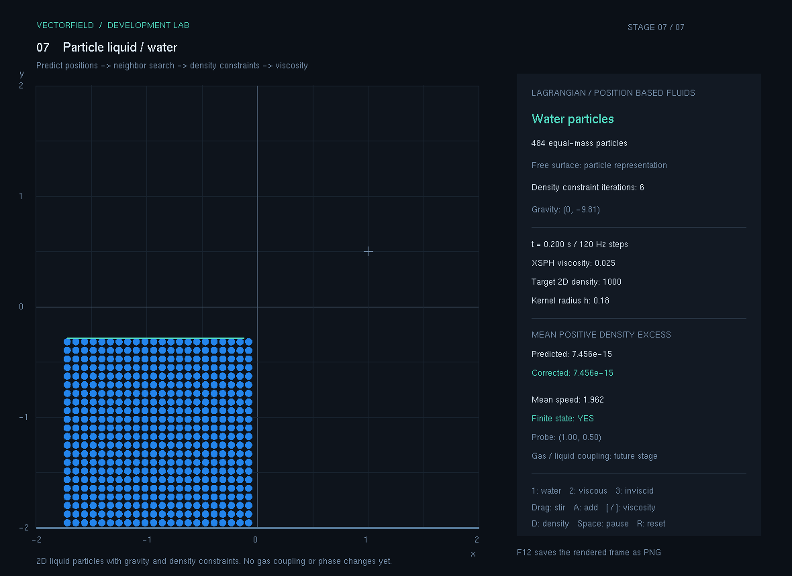
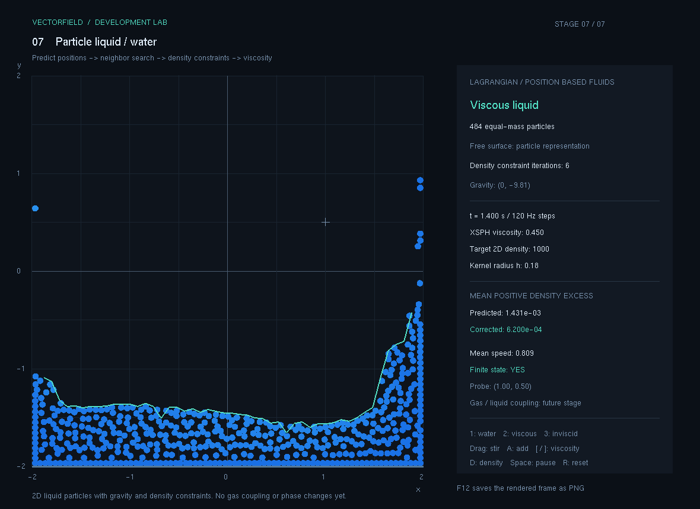
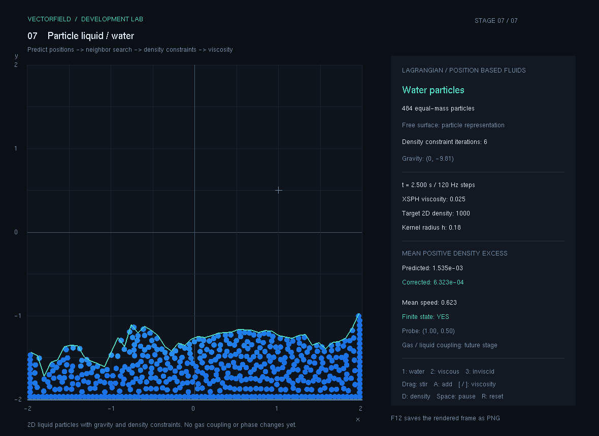

# 7. 물 입자

왼쪽에 쌓인 물 입자가 중력으로 무너지고 바닥을 따라 퍼지는 단계입니다. 입자 사이의 밀도를 계산하고 과도한 압축을 보정해 물의 부피를 근사적으로 유지합니다. 점성을 바꾸거나 마우스로 저어 움직임을 비교할 수 있습니다.

현재 상태: **구현·수치 검증·캡처 완료 — 2026-11-09**. 단계 실행 파일과 실제 PNG 네 장을 보관했습니다. 입력별 수동 확인 결과는 아래 표에 구분합니다.

## 이번 단계의 기능

- 484개 입자로 시작하는 물기둥 붕괴와 자유표면을 표시합니다.
- 이웃 입자의 밀도를 추정하고 PBF 위치 보정으로 압축을 줄입니다.
- 물, 점성이 큰 액체, 점성 없는 상태를 비교합니다.
- 왼쪽 버튼 드래그로 물을 젓고, 선택한 위치에 물을 추가합니다.
- 점성·기준 밀도를 조절하고, 입자 수·평균 속도·밀도 보정 전후 값을 확인합니다.

6단계의 기체는 격자에 저장한 속도·염료를 계산하고, 이 단계의 물은 입자 위치를 직접 움직입니다. 현재는 각 단계를 별도로 실행합니다. 물과 기체의 양방향 상호작용이나 온도에 따른 상변화는 이후 과제입니다.

## 실행과 조작

이 폴더의 `실행.cmd`를 더블 클릭합니다. 실행 파일은 `실행파일/VectorField.exe`이며, 같은 폴더에 있는 `freeglut.dll`이 필요합니다. 공통 실행기에서는 `F7`로 이동합니다.

GitHub에서는 `.exe`와 `.dll`을 직접 Git에 넣지 않으므로, 실행하려면 [배포/07_물입자.zip](../배포/07_물입자.zip)을 내려받아 압축을 푸세요. 이 ZIP 안에는 실행 파일과 필요한 DLL이 들어 있습니다. 루트의 `run.cmd`로 여는 최신 공통 실행기는 `F1`~`F7` 또는 `Tab`으로 단계를 전환합니다.

| 입력 | 동작 |
| --- | --- |
| `1` | 물 비교 설정: 점성 0.025 |
| `2` | 두꺼운 액체 비교 설정: 점성 0.45 |
| `3` | 점성 없는 비교 설정: 점성 0 |
| `[` | 점성을 절반으로 조절 |
| `]` | 점성을 두 배로 조절, 결과를 0.001~2로 제한 |
| `D` | 기준 밀도를 100씩 증가, 1,400 다음에는 800으로 순환 |
| 왼쪽 버튼 클릭·드래그 | 위치 선택, 드래그한 방향으로 근처의 물을 젓기 |
| `A` | 선택 위치에 최대 8×8개 입자 추가, 전체 최대 1,200개 |
| `Space` | 일시정지 / 재개 |
| `R` | 물의 초기 배치·속도·시간·점성·기준 밀도를 초기 설정으로 복원 |
| `Tab`, `F1`~`F7` | 단계 전환 |
| `F12` | 현재 OpenGL 프레임을 PNG로 저장 |

점성 설정은 같은 솔버에서 이웃 속도를 얼마나 섞을지 비교하는 기능입니다. `2`는 실제 기름이나 꿀의 물성을 재현하도록 측정·보정한 재료가 아닙니다. 물을 추가할 때는 기존 입자와 너무 가까운 후보 위치를 제외하므로 매번 64개가 모두 생성되지는 않습니다.

## 어떤 순서로 개발했는가

1. **물 상태를 입자에 저장했습니다.** 각 입자는 2차원 위치와 속도를 갖습니다. 기본 배치는 22×22개이며, 중력과 고정 `1/120초` 간격으로 다음 위치를 예측합니다.
2. **이웃 탐색 격자를 만들었습니다.** 반경 0.18 안의 입자를 찾기 위해 셀 크기 0.18인 균일 격자를 사용합니다. 위치를 보정하면 이웃 목록도 다시 계산합니다.
3. **이웃의 기여를 밀도로 바꿨습니다.** 2차원 poly6 커널의 합으로 밀도를 추정합니다. 입자 질량은 초기 격자의 밀도가 기준값 1,000에 맞도록 정했습니다.
4. **밀도 제약으로 압축을 줄였습니다.** 기준 밀도를 넘은 입자의 위치를 Jacobi 방식으로 최대 6회 보정합니다. 보정 후 평균 압축이 증가하면 이동량을 줄여 다시 시도합니다.
5. **벽과 접촉을 처리했습니다.** 입자 중심이 반지름을 고려한 용기 안에 머물게 하고, 정확히 겹친 입자도 분리되도록 가까운 거리의 접촉 보정을 추가했습니다.
6. **속도 복원과 점성을 연결했습니다.** 보정 전후 위치의 차이로 속도를 다시 구하고, XSPH 방식으로 이웃의 상대 속도를 완화합니다.
7. **화면과 입력을 연결했습니다.** 입자 크기를 반영한 파란 원, 속도에 따른 명암, 윗면 근사선과 계산 정보를 표시하고 드래그·물 추가·재료 비교 입력을 붙였습니다.

사용한 커널, 제약식, 점성식과 수치 안정화는 [계산과정.md](계산과정.md)에 설명했습니다.

## 화면에서 읽을 내용

입자는 반지름 0.033인 원으로 표시하며, 명암은 속도 크기를 보여 줍니다. 윗면 근사선은 x축을 50개 구간으로 나누고 각 구간에서 가장 높은 입자의 `y좌표 + 반지름`을 이은 것입니다. 입자가 없는 구간에서는 선을 끊습니다. 물 내부의 모든 경계나 물방울 표면을 복원한 선은 아닙니다.

오른쪽 정보 영역에서 다음 값을 확인합니다.

| 표시 | 의미 |
| --- | --- |
| 입자 수 | 현재 계산 중인 물 입자의 수 |
| 기준 밀도 | PBF 제약에서 사용하는 목표 밀도 |
| 점성 | 이웃의 상대 속도를 완화하는 계수 |
| 이웃 반경 | 밀도와 점성에 영향을 주는 거리, 기본 0.18 |
| 예측·보정 후 밀도 초과량 | 위치 보정 전후의 평균 양의 상대 밀도 오차 |
| 유한값 여부 | 위치·속도·계산 지표에 NaN이나 무한대가 없는지 확인 |
| 평균 속도 | 각 입자 속도 크기의 평균 |
| 중력 | 물 입자에 적용하는 가속도 |

밀도 초과량은 `mean(max(밀도 / 기준 밀도 - 1, 0))`입니다. 표시값 0.01은 이 정의에서 평균 초과량이 1%라는 뜻입니다. 자유표면에서 이웃 부족으로 생기는 밀도 부족이나 가장 심하게 압축된 한 입자의 오차까지 나타내지는 않습니다.

## 검증 기록

물 솔버 독립 검증은 **41개 통과, 실패 0개**입니다. 이 단계 보관본의 누적 자동 검증은 **173개 통과, 실패 0개**이며, 실제 출력은 [검증결과.txt](검증결과.txt)에 있습니다. 벡터 수학 69개, Dynamics 42개, FluidGrid 21개, 물 입자 41개를 한 번씩 실행한 결과입니다. 앞 단계 누계 132개에 이 173개를 다시 더하지 않습니다.

| 항목 | 독립 검증에서 확인한 결과 |
| --- | --- |
| 중력 | 단독 입자의 속도·위치 변화가 계산값과 일치 |
| 고정 시간 단계 | 반 시간 간격 2회가 고정 시간 간격 1회와 일치 |
| 압축 블록 보정 | 평균 밀도 초과량 1.57609 → 0.00167196 |
| 점성 | 외력이 없는 입자 쌍의 상대 운동 에너지가 줄고 운동량 유지 |
| 벽·바닥 | 입자 중심이 반지름을 고려한 영역 안에 유지 |
| 484개 입자, 600단계·중간 젓기 | 시뮬레이션 5초 동안 유한값·영역·입자 수 유지 |
| 위 시나리오의 최대 평균 밀도 초과량 | 예측 0.0151719, 보정 후 0.00793594 |
| 실제 물 화면·PNG | 4개 조건의 프레임 생성과 파일 열기 확인 |

| 수동 입력·장시간 실행 | 실제 확인 결과 |
| --- | --- |
| 물 안에서 드래그 | 평균 속도가 약 0에서 0.500으로 증가하고 파동 반응이 나타남 |
| `2` | 점성 0.450과 `Viscous liquid` 표시 확인 |
| 빈 공간 선택 후 `A` | 입자 수가 484개에서 548개로 증가하고 물 블록이 생성됨 |
| 장시간 실행 | 약 97초 경과 화면에서도 `Finite state: YES` 확인 |

수동 입력 확인 범위는 위 항목입니다.

검증 지표는 정해진 초기 조건에서 얻은 관측값입니다. 모든 물의 움직임이나 재료 설정에서 같은 오차가 보장되는 것은 아닙니다.

## 실행 화면 기록

아래 네 장은 직접 실행한 프로그램에서 저장하고 열어 확인한 OpenGL 프레임입니다. 모두 484개 입자, 기준 밀도 1,000, 중력 (0,-9.81), 반경 h=0.18, 고정 1/120초 간격을 사용했습니다.

| 파일 | 재현 조건과 관찰할 내용 |
| --- | --- |
| `캡처/01_물붕괴.png` | 점성 0.025, 초기화 후 정확히 0.200초. 왼쪽 물기둥이 낙하하기 시작하는 모습 |
| `캡처/02_자유표면.png` | 점성 0.025, 초기화 후 정확히 1.400초. 바닥으로 퍼진 물과 자유표면 |
| `캡처/03_점성비교.png` | 점성 0.45, 초기화 후 정확히 1.400초. 기본 물과 같은 시점에서 움직임 비교 |
| `캡처/04_물젓기.png` | 점성 0.025, 초기화 후 정확히 2.500초. 1.2초에 `(0.3,-1.1)`에서 변위 `(0.18,0.16)`의 젓기 입력 1회 |

네 번째 장면의 자동 재현에는 `--stir-demo` 옵션을 사용합니다. 마우스로 직접 젓는 경우에는 드래그 경로와 입력 횟수가 달라 같은 결과가 나오지 않을 수 있습니다.

0.200초, 점성 0.025. 물기둥이 바닥을 향해 낙하하며 평균 속도는 약 1.962입니다.

1.400초, 점성 0.025. 물이 양옆으로 퍼지고 벽을 타고 올라간 모습과 윗면 근사선을 볼 수 있습니다.

1.400초, 점성 0.45. 같은 시점의 기본 물보다 평균 속도가 작아진 비교 장면입니다.

2.500초, 점성 0.025. 재현용 젓기 입력 이후의 입자 분포와 밀도 보정 전후 값을 함께 기록했습니다.

## 보관 파일과 현재 한계

`실행.cmd`, `실행파일/`, `소스/전체소스.zip`, `검증결과.txt`, `캡처/`에 단계의 실행과 근거를 보관합니다. 전체 배포 묶음은 [배포/07_물입자.zip](../배포/07_물입자.zip)입니다. 소스 압축을 별도 폴더에 풀고 그 안의 `build.cmd`를 실행하면 해당 시점을 다시 빌드할 수 있습니다. 공통 실행기에서 단계 전환 후 저장하는 캡처는 `captures/stage-07/`처럼 단계별 폴더로 나뉩니다.

계산은 [`WaterParticles.h`](../opgnel_project_smoke/WaterParticles.h), 검증은 [`WaterParticleTests.h`](../tests/WaterParticleTests.h)에 있습니다. 화면의 원과 윗면 선은 낮은 해상도의 2차원 입자 결과를 보여 주는 근사 표시입니다. 미세한 물방울·표면 장력·젖음·강체와의 양방향 상호작용은 구현하지 않았습니다. 속도 제한, 벽 감쇠와 유한 횟수 제약 보정도 포함합니다.

다음 확장에서는 물·기체 사이의 압력과 힘 교환, 온도장, 열전달과 상변화를 각각 검증 가능한 기능으로 나눠 추가할 수 있습니다. 현재 구현에는 물속 기포, 공기 저항, 증발·응결·동결 계산이 없습니다.
