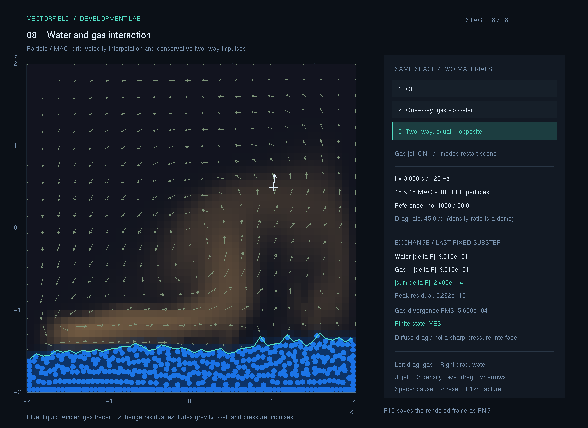
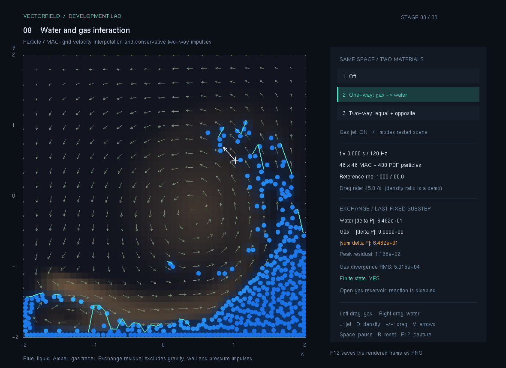
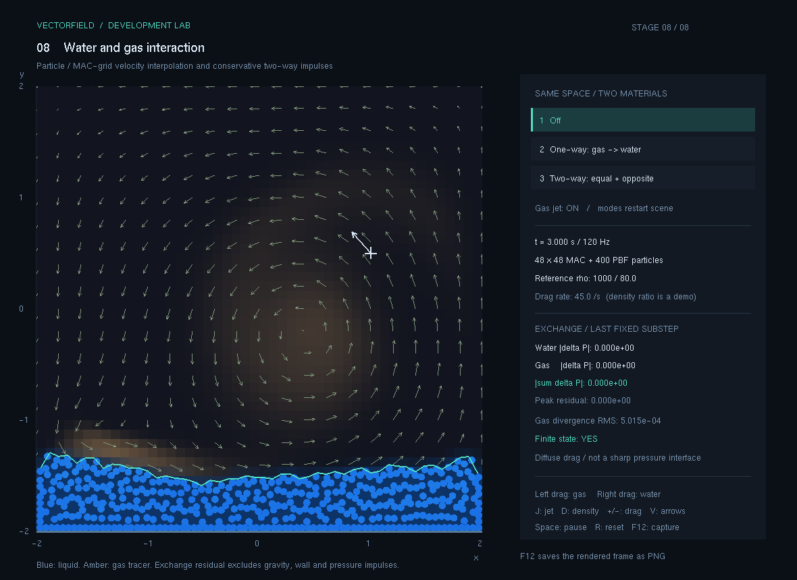
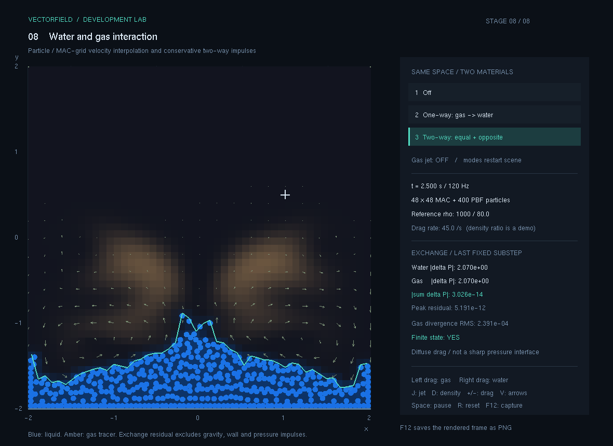

# 8. 다중 재료 상호작용

물 입자와 기체 격자를 같은 `[-2,2] × [-2,2]` 공간에 놓고 서로의 운동에 영향을 주도록 연결하는 단계입니다. 기체 속도를 읽어 물만 움직이는 경우와, 물이 받은 충격량의 반작용까지 기체에 돌려주는 경우를 비교합니다.

현재 상태: **구현·통합 수치 검증·실제 PNG 4장·대표 입력 확인 완료 — 2026-11-09**. 공통 앱의 214개 검사가 모두 통과했습니다. 실제 확인한 수동 입력 범위는 자동 검사·캡처와 구분해 아래에 기록했습니다.

## 이번 단계의 기능

- 같은 공간에 기체의 염료·속도와 물 입자·자유표면을 함께 표시합니다.
- 결합 해제, 단방향, 양방향 모드를 같은 초기 조건에서 비교합니다.
- 기체의 국소 속도와 물 입자의 속도 차이로 교환 충격량을 계산합니다.
- 양방향 모드에서는 물과 기체에 크기가 같고 방향이 반대인 운동량 변화를 적용합니다.
- 물 입자로부터 매끄러운 점유도를 구해 물이 조밀한 곳의 기체 추적 염료를 줄입니다.
- 물·기체의 운동량 변화와 결합 연산의 잔차를 계산 상태에서 직접 측정합니다.

이 단계는 기존 MAC 기체 솔버와 PBF 물 솔버를 잇는 **확산 경계의 항력·충격량 교환 모델**입니다. 기체 계산 격자는 물 안에도 이어져 있고, 점유도는 추적 염료와 결합 강도를 조절합니다. 물의 경계에서 기체 압력을 정확히 자르는 비혼합 두 유체 솔버는 아닙니다. 점유도로 염료를 줄이는 연산을 기체 질량·부피의 엄밀한 배제로 해석하지 않습니다.

## 실행과 조작

이 폴더의 `실행.cmd` 또는 공통 실행기의 `--stage 8`로 실행합니다. GitHub에서 실행본을 받을 때는 [배포/08_다중재료상호작용.zip](../배포/08_다중재료상호작용.zip) 전체를 내려받아 풀어 실행합니다. EXE와 `freeglut.dll`을 함께 보관합니다.

공통 실행기에서는 `F8` 또는 `Tab`으로 이동합니다.

```powershell
.\run.cmd --stage 8
```

| 입력 | 동작 |
| --- | --- |
| `1` | 결합 해제 기준 장면으로 초기화 |
| `2` | 단방향 결합 장면으로 초기화 |
| `3` | 양방향 결합 장면으로 초기화 |
| 왼쪽 버튼 클릭·드래그 | 기체에 추적 염료와 속도 증분 입력 |
| 오른쪽 버튼 드래그 | 근처의 물 입자를 젓기 |
| `J` | 기체 분출원 켜기 / 끄기 |
| `D` | 기체 기준 밀도 80 / 1.2 비교, 같은 초기 장면으로 재시작 |
| `+`, `-` | 항력률을 5씩 조절, UI 범위 0~150 |
| `V` | 기체 속도 화살표 표시 전환 |
| `A` | 선택 위치에 물 입자 추가 |
| `Space` | 일시정지 / 재개 |
| `R` | 기본 초기 조건으로 복원 |
| `F1`~`F8`, `Tab` | 단계 전환 |
| `F12` | 실제 OpenGL 프레임을 PNG로 저장 |

`1`~`3`은 비교가 쉽도록 시간과 장면을 초기화하고 선택한 기체 밀도·항력률·분출 설정과 일시정지 상태를 유지합니다. 서로 다른 모드의 화면을 비교할 때는 이 매개변수와 경과 시간을 같게 둡니다. 실제 조작을 확인한 범위는 검증표에 별도로 남겼습니다.

기본 장면은 48×48 기체 격자와 20×20개, 총 400개의 물 입자로 시작합니다. 물의 기준 밀도는 1,000, 기체의 기준 밀도는 80이고 항력률은 45입니다. 밀도비 12.5는 낮은 해상도에서 두 매체의 반응을 관찰하기 위한 교육용 설정입니다. 실제 물·공기의 물성을 측정해 맞춘 값이 아닙니다. `D`의 1.2 설정도 같은 2차원 모델의 비교이며, 압축성 상태방정식이나 실제 온도·기압을 계산하는 기능은 아닙니다.

`D`는 기체의 이산 질량을 바꾸는 비교 입력이므로 같은 초기 장면으로 다시 시작합니다. 밀도 변경 전후를 이어 붙여 총 운동량 보존을 판단하지 않습니다. 결합 잔차는 고정된 밀도로 실행한 한 번의 교환 직전·직후를 비교합니다.

## 개발 순서

1. **두 매체의 좌표와 단위를 맞췄습니다.** 물 입자는 실제 공간 좌표를 사용하고, 기체 주입·표본 추출 API는 정규화 좌표를 사용합니다. 위치 변환과 속도 단위를 구분했습니다.
2. **경계 주변의 상태를 옮겼습니다.** 물 입자 위치에서 MAC 면 속도를 표본 추출하고, 같은 가중치를 기체에 반작용을 나눠 주는 데 사용했습니다.
3. **상대 속도를 줄이는 충격량을 풀었습니다.** 각 매체의 이산 질량을 반영해 물과 기체가 얼마나 속도를 바꿀지 계산했습니다. 결합 연산이 상대 운동 에너지를 새로 만드는지도 검사했습니다.
4. **실제 배열에서 운동량을 다시 측정했습니다.** 반작용 값을 장부에 음수로 적는 데 그치지 않고, 연산 전후 입자 속도와 MAC 면 속도의 합으로 잔차를 계산했습니다.
5. **점유도와 화면을 연결했습니다.** 물의 이동에 따라 조밀한 물 내부의 추적 염료를 줄이고, 물 입자와 기체 흐름을 같은 좌표계에 그렸습니다. 이 표시 연산과 실제 운동량 교환은 따로 구분했습니다.
6. **비교와 검증을 남겼습니다.** 같은 초기 조건·시간 단계에서 세 모드를 실행하고, 물의 움직임과 기체의 반응이 모두 달라지는지 수치와 화면으로 확인했습니다.

정확한 교환식, 질량 정의, 경계 처리와 계산 순서는 [계산과정.md](계산과정.md)에 구현 기준으로 정리했습니다.

## 화면에서 읽을 내용

물 입자는 파란 원과 윗면 근사선, 기체는 추적 염료와 선택 가능한 속도 화살표로 표시합니다. 물과 기체의 그림을 겹친 것만으로 양방향 결합을 판정하지 않고 다음 상태를 함께 읽습니다.

| 지표 | 의미 |
| --- | --- |
| 결합 모드 | 교환 없음 / 기체→물 / 물↔기체 |
| 두 매체의 기준 밀도 | 교환에서 관성을 정하는 비교용 매개변수 |
| 물·기체 충격량 | 마지막 교환 연산 전후 실제 속도 상태에서 측정한 운동량 변화 |
| 결합 잔차 | 위 두 변화량의 벡터 합 |
| 최대 잔차 | 초기화 이후 교환 연산에서 관찰한 가장 큰 잔차 크기 |
| 기체 발산 RMS | 교환 후 압력 투영까지 진행한 기체 속도의 발산 |
| 물 입자 수·유한값 | 입자 수와 NaN·무한대 여부 |

단방향 모드의 잔차가 0이 아닌 것은 반작용을 의도적으로 생략한 결과입니다. 양방향 모드의 보존 잔차와 같은 완료 기준을 적용하지 않습니다. 기체가 물을 움직이는 효과는 물의 이동을, 물이 기체를 바꾸는 효과는 기체 속도장의 차이를 통해 확인합니다.

## 검증 기록

신규 결합 검사 41개는 MSVC C++14 독립 실행에서 모두 통과했습니다. 공통 앱의 x64 Release 빌드에서도 기존 173개와 신규 41개를 순서대로 실행해 **214개 통과, 실패 0개, 종료 코드 0**을 확인했습니다. 전체 실제 출력은 [검증결과.txt](검증결과.txt)에 보관했습니다. 단계별 보관본에 같은 공통 검사 출력이 있어도 다시 더하지 않습니다.

| 항목 | 확인할 내용 | 상태 |
| --- | --- | --- |
| 평형 | 기체와 물의 속도가 같을 때 불필요한 교환이 없는가 | 독립 검사 통과 |
| 운동량 | 교환 전후 실제 속도 배열에서 물·기체의 운동량 합이 유지되는가 | 독립 검사 통과 |
| 에너지 | 외력을 제외한 양방향 교환이 두 매체의 총 운동 에너지를 증가시키지 않는가 | 독립 검사 통과 |
| 양방향 효과 | 기체가 물을 움직이고, 물의 운동이 기체 상태도 바꾸는가 | 독립 검사 통과 |
| 모드 비교 | 결합 해제·단방향·양방향의 차이가 같은 조건에서 재현되는가 | 독립 검사 통과 |
| 점유도 | 값이 유한하고 0~1 범위에 있는가 | 독립 검사 통과 |
| 시간 진행 | 여러 고정 단계 동안 유한값·벽 조건·입자 수가 유지되는가 | 독립 검사 통과 |
| 실제 화면 | 두 매체가 함께 표시되는 네 조건을 직접 실행해 PNG로 저장·열람 | 확인 완료 |
| 대표 수동 입력 | 아래 표에 적은 입력과 표시 변화를 실제 창에서 확인 | 해당 범위 확인 완료 |

실제 속도 배열을 다시 합산한 비균일 교환 시험에서 운동량 잔차는 약 `3.24×10⁻¹³`이었고, 총 운동 에너지는 `8013.58 → 6694.70`으로 줄었습니다. 24×24 격자에서 5초 동안 진행한 시험의 최대 교환 잔차는 약 `4.03×10⁻¹²`였으며, 물 입자 400개와 질량을 유지했습니다.

같은 24×24 조건에서 3초 동안 세 모드를 진행한 비교는 다음과 같습니다. 물은 같은 번호 입자의 위치 차이 RMS, 기체는 셀 중심 속도 벡터 차이 RMS입니다.

| 비교 | 물 위치 차이 RMS | 기체 속도 차이 RMS |
| --- | ---: | ---: |
| 결합 해제 ↔ 단방향 | 1.47430326 | 0 |
| 결합 해제 ↔ 양방향 | 0.59411260 | 1.23255217 |

단방향은 물만 바꾸고 기체 속도는 그대로이며, 양방향은 두 상태를 모두 바꿉니다. 이 결과는 화면의 겹침이나 염료 가림 효과만으로 상호작용을 판정한 것이 아니라 실제 계산 상태를 비교한 것입니다. 자동 시험은 24×24, UI 기본은 48×48이므로 화면에서 수치가 완전히 같게 나오지는 않습니다.

결합 해제와 단방향의 차이에는 움직이지 않는 기체가 낙하하는 물에 주는 저항도 포함됩니다. 분출원 자체의 효과를 구분하기 위해 같은 단방향 모드에서 분출원을 켠 경우와 끈 경우도 비교했습니다. 3초 뒤 물 위치 차이 RMS는 `1.34211326464`로, 기체 분출이 물의 경로를 바꾼다는 것을 확인했습니다.

별도 작성한 [독립 검증기](검증/README.md)는 네 해상도·네 기체 밀도·네 교환 간격의 64개 벽 근처 상태를 실제 배열로 다시 검사했습니다. 최대 상대 운동량 잔차는 약 `1.46×10⁻¹⁵`, 운동 에너지 증가와 실패는 0이었습니다. UI 기본 48×48의 5초 진행도 유한값·벽·400개 입자와 질량을 유지했습니다. 전체 출력은 [독립검증결과.txt](독립검증결과.txt)에 있습니다. 이 추가 검사의 64개 조건을 공통 214개의 검사 수에 다시 더하지 않습니다.

중력, 노즐, 사용자 입력과 닫힌 벽은 계의 외부에서 운동량을 바꿀 수 있습니다. 압력 투영과 PBF 벽 보정도 따로 작동하므로, 전체 시뮬레이션의 운동량 변화와 **결합 연산만의 보존 잔차**를 같은 지표로 다루지 않습니다.

### 실제 창에서 확인한 입력

| 입력·조건 | 실제 관찰 결과 |
| --- | --- |
| `Space` | 시간이 멈추고 `PAUSED` 표시 |
| 일시정지 중 단방향 버튼 클릭 | 단방향 모드로 바뀌고 시간0, 일시정지 유지 |
| `3` | 양방향 기본 장면으로 초기화 |
| `D`, 다시 `D` | 기체 기준 밀도1.2와80을 전환하고 각각 시간0으로 재시작 |
| `J` | 기체 분출원 `OFF` 표시 |
| 일시정지 중 왼쪽 드래그 | 이 환경의 창 좌표 `(180,590)→(325,495)`에서 추적 염료와 기체 속도 화살표 변화. 시간0과 교환량0은 유지 |
| 위 입력 뒤 `Space`로 재개 | 0.050초에서 물·기체 운동량 변화 크기 각각 약6.099, 합 잔차 `7.319×10⁻¹³`, `Finite state: YES` |
| `F8` 재진입 | 48×48 격자·400개 입자·기체 밀도80·분출원 켬으로 복원 |
| 경과 약98.8초의 화면과 `F12` | `Finite state: YES`, PNG 저장 표시와 실제 `x64/Release/captures/stage-08/01_양방향.png` 파일 생성 확인 |

수동 확인 범위는 위 항목입니다. 오른쪽 버튼 드래그는 실제 버튼을 눌러 확인하지 않았습니다. 해당 입력의 코드 연결을 검토했고, 아래 반작용 장면의 CLI 재현이 같은 물 젓기 `Stir()` 연산을 실행하는 것은 확인했습니다. 그 외 모든 키를 전수 시험했다고 표시하지 않습니다. 약98.8초의 유한값 관찰도 한 장면의 관측이며 모든 입력의 장기 안정성을 보장하는 결과는 아닙니다.

## 실행 화면 기록

아래 네 장면은 실제 OpenGL 프레임을 저장하고 열어 확인했습니다. 첫 세 장면은 같은 초기 조건에서 정확히 3초까지 진행했습니다. 모두 48×48 격자,400개 물 입자, 기준 밀도 1,000/80, 항력률 45, 고정 1/120초 조건입니다. 첫 세 장은 기체 분출원을 켜고, 네 번째 반작용 장면은 기체 분출을 끕니다.

| 파일 | 비교할 내용 |
| --- | --- |
| `캡처/01_양방향.png` | 3.000초. 물과 기체가 충격량과 반작용을 주고받는 장면 |
| `캡처/02_단방향.png` | 3.000초. 기체가 물에 작용하고 반작용은 돌려주지 않는 비교 장면 |
| `캡처/03_결합해제.png` | 3.000초. 같은 공간에서 교환 연산만 끈 기준 장면 |
| `캡처/04_물의반작용.png` | 2.500초. 기체 분출을 끄고 물의 낙하·젓기에서 기체 흐름이 생기는 장면 |



3.000초의 양방향 결합입니다. 마지막 고정 단계에서 물·기체가 받은 운동량 변화의 크기는 각각 약 0.932이며, 두 **벡터 변화량의 합**은 약 `2.41×10⁻¹⁴`입니다. 두 매체의 충격량 크기가 비슷하다는 것만으로 보존을 판단하지 않고 벡터 합 잔차와 실제 배열 검사를 함께 확인합니다.



같은 3.000초의 단방향 결합입니다. 마지막 단계의 물 충격량 크기는 약 64.82이고 기체 반작용은 0이므로 잔차도 그만큼 남습니다. 기체를 무한한 속도 저장소로 취급한 비교라 물이 더 크게 움직이며, 이 모드의 운동량이 보존된다고 표시하지 않습니다.



같은 3.000초의 결합 해제 기준입니다. 교환 충격량은 0입니다. 물이 기체의 추적 염료를 가리는 표시 연산은 남아 있지만, 물과 기체의 속도 사이에 충격량을 주고받지는 않습니다. 이 장면의 농도 모양만으로 기체가 물을 피해 흐른다고 판정하지 않습니다.



2.500초의 양방향 결합입니다. 기체 분출원은 껐고 초기 속도도 0입니다. 흐름을 읽을 수 있도록 정규화 위치 `(0.24,0.38)`, `(0.77,0.38)`에 농도 0.8·반경 0.15의 수동 추적 구름만 놓았습니다. 이 염료에 부력을 적용하거나 기체 속도를 주입하지 않습니다. 물의 낙하와 1.2초의 젓기 입력에서 기체 속도가 생기고 추적 구름도 이동합니다.

젓기 입력은 실제 좌표 `(0.3,-1.1)`에서 변위 `(0.18,0.16)`을 한 번 적용했습니다. 마지막 고정 단계의 물·기체 운동량 변화 크기는 각각 약 2.070, 합 잔차는 약 `3.03×10⁻¹⁴`입니다. 자동 재현에는 `--no-jet --reaction-demo`를 사용했습니다.

```powershell
.\run.cmd --stage 8 --coupling-mode 2 --no-jet --reaction-demo
```

## 보관 파일

| 경로 | 내용 |
| --- | --- |
| `README.md` | 기능, 개발 순서, 조작과 실제 검증 범위 |
| `계산과정.md` | 교환식, 단위, 질량·가중치·진단의 정의 |
| `검증결과.txt` | 실제 자동 검사 출력 |
| `캡처/` | 실제 OpenGL 실행 프레임 |
| `실행.cmd`, `실행파일/` | 단계 보관본과 필요한 DLL |
| `소스/전체소스.zip` | 완성 시점에 다시 빌드할 수 있는 소스 묶음 |

기체·물의 양방향 결합을 확인한 뒤에도 경계 해상도, 압력 연속 조건, 물질별 질량·에너지 보존과 열·상변화는 별도로 검증해 확장합니다.
