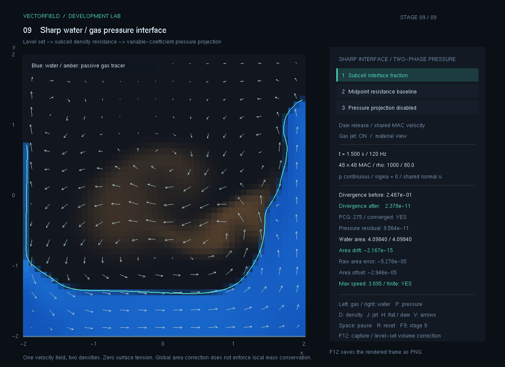
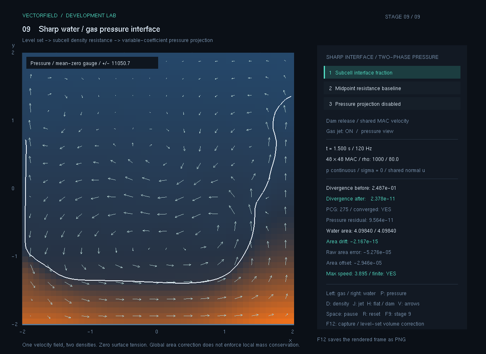
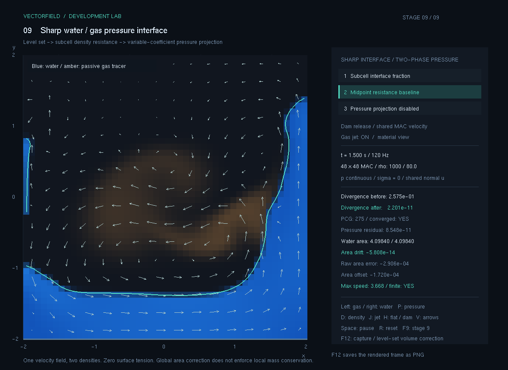
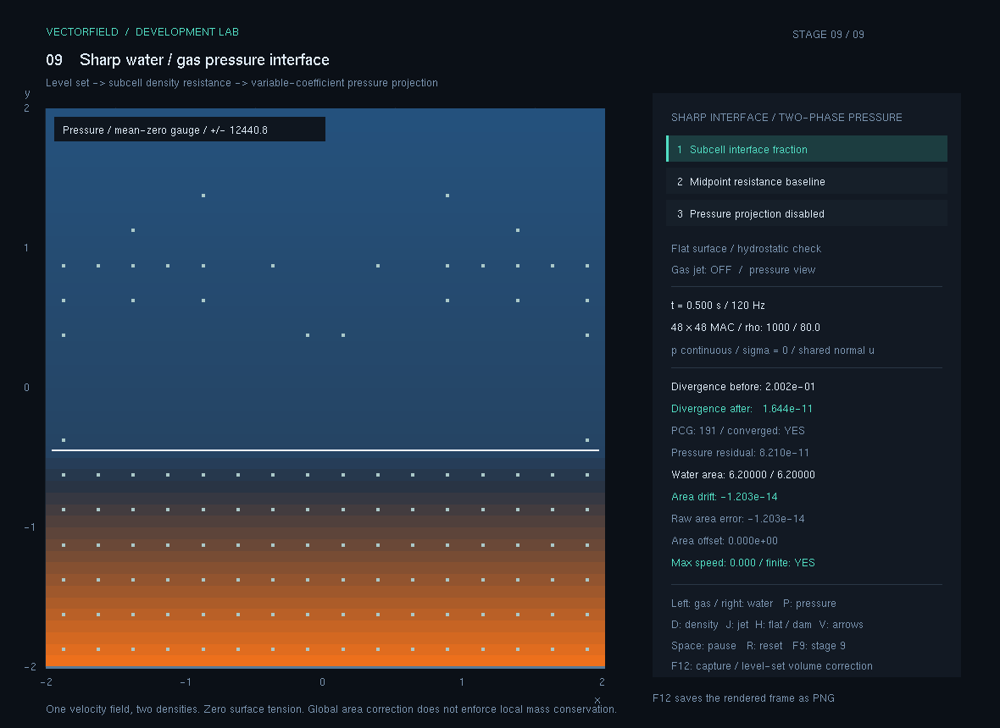
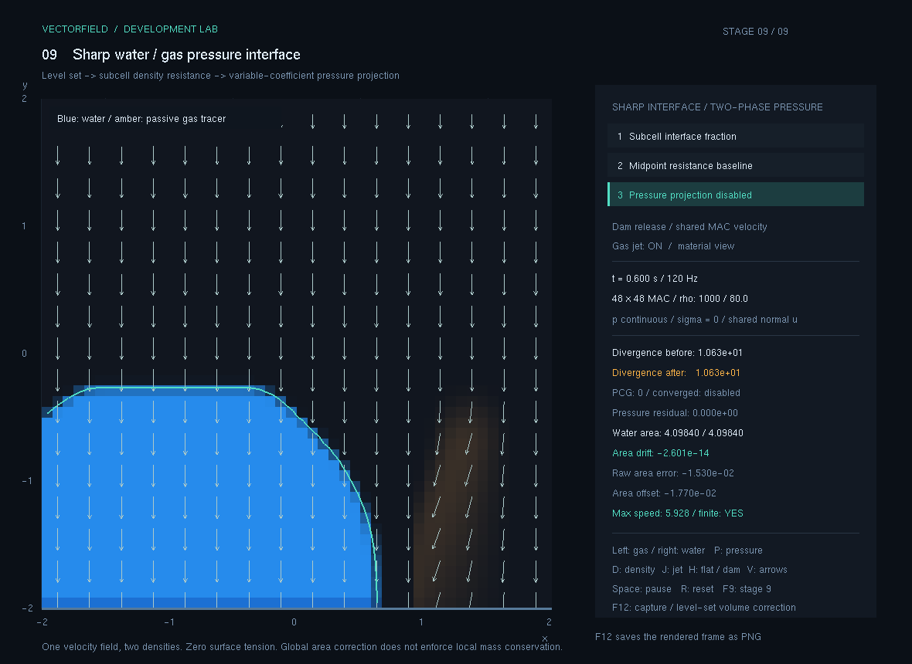

# 9. 정밀 계면

물과 기체를 나누는 경계의 위치를 셀 내부까지 추정하고, 두 재료의 밀도를 반영한 하나의 압력 문제를 푸는 단계입니다. 압력 투영에서 구한 보정이 물과 기체 양쪽의 공유 속도에 적용됩니다.

현재 상태: **구현·통합 수치 검증·실제 PNG 5장·대표 입력 확인 완료 — 2026-11-09**. 최종 x64 Release 앱에서 기존 214개와 신규 계면 40개를 합쳐 254개가 통과했고 실패는 0개입니다. 실제 확인한 입력 범위는 자동 검사와 구분해 아래에 기록했습니다.

## 8단계에서 이어지는 점

8단계는 PBF 물 입자와 기체 MAC 격자 사이에 항력 충격량을 교환했습니다. 9단계는 두 재료의 압력 경계를 계산하기 위해 **단일 속도를 사용하는 오일러 격자 모델**을 별도로 추가합니다. 물은 음의 레벨셋 영역, 기체는 양의 영역으로 나뉘며 두 상의 압력을 함께 풉니다. 8단계의 코드와 보관본은 비교용으로 유지합니다.

| 항목 | 8단계 | 9단계 |
| --- | --- | --- |
| 물의 상태 | PBF 입자 위치·속도 | 레벨셋으로 구분한 격자 영역 |
| 속도 | 물 입자 속도와 기체 면 속도 | 두 상이 공유하는 MAC 면 속도 |
| 압력 | 기체 투영과 물의 밀도 제약이 별도 작동 | 밀도가 다른 두 상을 잇는 변수 계수 압력 투영 |
| 경계 위치 | 매끄러운 점유도와 노출 계수 | 레벨셋의 부호 변화와 셀 내부 교차 비율 |
| 비교 기준 | 항력 반작용과 교환 운동량 | 압력 계수, 발산, 정수압 균형과 면적 오차 |

9단계는 표면장력과 점성 응력 차이를 생략해 계면 압력을 연속으로 둡니다. 압축성 기체의 상태방정식이나 실제 온도·기압을 계산하는 모델은 아닙니다.

## 개발 과정

1. **압력 계산의 상태를 통일했습니다.** 물과 기체에 각각 다른 속도를 두는 대신 같은 MAC 면 속도를 사용하고, 셀 중심에는 계면 함수와 압력을 저장합니다.
2. **경계가 셀 사이 어디에 있는지 계산했습니다.** 이웃 셀의 레벨셋 값으로 영점 위치를 선형 추정하고, 각 재료가 차지하는 중심 간 길이 비율을 구합니다.
3. **압력 전달 계수를 만들었습니다.** 같은 재료 사이에는 역밀도를, 경계를 가로지르는 면에는 길이로 가중한 밀도의 역수를 사용합니다.
4. **두 상의 압력을 함께 풀었습니다.** 같은 면 계수로 압력 행렬과 속도 보정을 구성하고, 닫힌 용기의 압력 기준값 자유도를 처리합니다.
5. **움직이는 경계를 관리했습니다.** 공유 속도로 레벨셋을 이류하고 거리장을 다시 정리합니다. 이 과정의 면적 오차와 전역 보정을 구분해 기록합니다.
6. **다른 오차를 나누어 비교했습니다.** 정밀 교차 비율·중점 가정·압력 투영 해제, 정수압 장면과 높은 밀도비 시험을 따로 확인합니다.

계산식과 변수 정의, 압력 계수의 숫자 예시는 [계산과정.md](계산과정.md)에 있습니다.

## 실행과 조작

이 폴더의 실행.cmd 또는 공통 실행기에서 9단계를 엽니다. GitHub 실행본은 [09_정밀계면.zip](../배포/09_정밀계면.zip) 전체를 내려받아 풀어 사용합니다.

~~~powershell
.\run.cmd --stage 9
~~~

| 입력 | 동작 |
| --- | --- |
| 1 | 실제 교차 비율을 사용하는 정밀 계면 장면으로 재시작 |
| 2 | 교차 비율을 0.5로 가정한 중점 비교 장면으로 재시작 |
| 3 | 압력 투영을 끈 비교 장면으로 재시작 |
| 왼쪽 드래그 | 기체 영역에 속도 증분과 추적 염료 입력 |
| 오른쪽 드래그 | 물 영역의 공유 면 속도를 젓기 |
| P | 재료 표시 / 압력 분포 표시 전환 |
| V | 공유 속도 화살표 표시 전환 |
| J | 기체 분출원 켜기 / 끄기 |
| D | 기체 밀도 80 / 1.2 비교 |
| H | 물기둥 / 수평 계면 정수압 장면 전환 |
| Space | 일시정지 / 재개 |
| R | 기본 장면으로 복원 |
| F1~F9, Tab | 단계 전환 |
| F12 | 실제 OpenGL 프레임을 PNG로 저장 |

실제 조작을 확인한 범위는 자동 검사와 구분해 검증 기록에 남깁니다.

수평 정수압 장면에 들어가면 분출원을 끕니다. 물기둥으로 돌아올 때도 현재 분출 설정을 유지하므로, 다시 분출시키려면 J로 켭니다. 화면의 압력은 평균 0 기준의 상대 압력이며, 색상은 절대 대기압을 뜻하지 않습니다.

기본 해상도는 48×48이고 물·기체 기준 밀도는 1000/80입니다. 밀도비 12.5는 8단계와 마찬가지로 두 매체의 반응을 관찰하기 위한 교육용 설정입니다. D의 기체 밀도 1.2는 물·공기에 가까운 밀도비를 비교하기 위한 조건이며, 이 비압축 2차원 모델이 실제 기체의 온도·기압·압축성을 재현하는 것은 아닙니다.

압력 표시의 색상 범위는 현재 평균 0 압력의 최대 절댓값으로 양·음 대칭 조정합니다. 따라서 서로 다른 장면의 색만으로 압력 크기를 비교하지 않습니다. 음의 색상은 이 기준 아래의 상대 압력을 뜻하며, 음의 절대압을 뜻하지 않습니다.

## 검증 기준과 실제 결과

최종 공통 실행기의 x64 Release 빌드에서 **254개 통과, 실패 0개, 종료 코드 0**을 확인했습니다. 이 중 새 정밀 계면 검사는 40개이며, 전체 실제 출력은 [검증결과.txt](검증결과.txt)에 보관했습니다. 단계별 보관본의 공통 검사 수를 다시 더하지 않습니다.

별도로 작성한 [독립 검증기](검증/README.md)는 최종 코어로 실제 실행해 **70개 검사 통과, 실패 0개**를 확인했습니다. 실제 출력은 [독립검증결과.txt](독립검증결과.txt)에 있습니다. 이 개수는 공통 앱의 검사 수에 중복 합산하지 않습니다.

독립 검증의 48개 임의 투영 조건에서 1,488개 교차 면을 확인했고, 연속 구간별 선형 압력의 전달 플럭스 오차는 최대 약 $3.00\times10^{-15}$였습니다. 투영 뒤/전 발산 비율의 최대값은 약 $9.95\times10^{-11}$이고, 면 질량으로 가중한 운동 에너지 증가는 없었습니다.

48² 기본 장면을 기체 밀도 80과 1.2에서 각각 600회·5초 진행한 결과도 유한값·닫힌 벽·표시 상 분율 범위를 유지했습니다. 보정 뒤 물 면적의 최대 상대 변화는 각각 약 $6.85\times10^{-14}$, $6.54\times10^{-14}$입니다. 이는 전역 레벨셋 면적 보정의 결과이며, 국소 보존형 재료 수송을 검증한 수치가 아닙니다.

| 항목 | 확인할 내용 | 실제 결과 |
| --- | --- | --- |
| 면 계수 | 계면 교차 비율과 두 밀도에 따른 전달 계수 | 기준 플럭스 1에 대해 정밀 1, 중점 약1.30325926 |
| 제조해 | 알려진 압력·플럭스에서 구한 수치해의 오차 | 압력 RMS 약 $6.95\times10^{-9}$ |
| 정수압 | 수평 계면에서 중력과 압력이 균형을 이루는가 | 정밀 압력 RMS 최대 약 $1.37\times10^{-8}$ |
| 발산 | 두 상의 압력 투영 뒤 발산이 줄어드는가 | 실제 면 합산 RMS $3.36586\rightarrow3.11\times10^{-10}$ |
| 중점 비교 | 실제 교차 비율을 버렸을 때 경계 오차가 커지는가 | 같은 정수압의 중점 압력 RMS 최대 약58.6744 |
| 높은 밀도비 | 기체 밀도 1.2에서도 압력 풀이와 시간 진행이 유한한가 | 검사 통과 |
| 경계와 면적 | 닫힌 벽과 레벨셋 면적 오차·보정량 확인 | 48²·600스텝에서 벽·유한값 유지, 보정 후 상대 면적 오차 최대 약 $6.85\times10^{-14}$ |
| 실제 화면 | 비교 장면을 실행해 PNG 저장·열람 | 1180×860의 실제 OpenGL PNG 5장 확인 |

압력 투영의 잔차, 계면 위치의 오차와 레벨셋 이류의 면적 오차는 서로 다른 지표입니다. 압력 풀이가 수렴했다고 재료 경계의 이동까지 정확하거나 국소 질량이 보존된다고 결론 내리지 않습니다.

공통 검사의 정수압은 32²에서 기체 밀도 1.2·80·1000을 비교한 압력 자체의 RMS입니다. 독립 검증의 압력 충격량 최대 오차와 합산 단위가 다릅니다. 기본 48² 물기둥을 5초 진행한 공통 검사에서 보정 전 면적 상대 오차는 최대 약 0.002493, 보정 후에는 약 $6.85\times10^{-14}$였습니다. 줄어든 총합 오차가 국소 경계의 정확한 이동을 뜻하지는 않습니다.

### 실제 창에서 확인한 입력

| 입력·조건 | 실제 관찰 |
| --- | --- |
| 수평 정수압·압력 표시의 경과21.842초 | 평평한 수면, 유한값 유지, PCG191회 수렴, 발산 약 $0.2002\rightarrow1.644\times10^{-11}$ |
| Space | 시간 정지와 PAUSED 표시 |
| P, V | 재료 표시 전환과 공유 속도 화살표 끄기/켜기 |
| 일시정지 중 2 버튼 클릭 | 중점 계수 모드, 시간0, 일시정지 유지 |
| 3 | 압력 투영 해제 모드와 시간0 |
| 1·D·H·J 입력 뒤 | 정밀 계수·물기둥·기체 밀도1.2·분출원 켬·시간0의 일시정지 상태 |
| 일시정지 중 왼쪽 드래그 | 이 환경의 창 좌표 (495,535)→(608,428), 기체 염료와 속도 변화, 최대 속력 약4.443 |
| 재개 뒤 다시 일시정지 | 2.767초, 유한값 유지, PCG282회 수렴, 발산 약 $0.1695\rightarrow1.640\times10^{-11}$ |
| F8→F9 | 8·9단계 창 제목 전환과 9단계 기본 밀도80·물기둥·분출원 복원 |
| F12 | PNG 저장 표시와 실제 x64/Release/captures/stage-09/01_정밀계면.png 생성 확인 |

수동 확인은 위 범위입니다. 오른쪽 물 젓기 드래그와 R은 이번에 실제 버튼·키로 시험하지 않았습니다. 입력의 코드 연결을 검토했고, 물 젓기와 같은 Stir 연산은 600스텝 자동 검사에서 실행했습니다. 경과21.842초의 유한값 관찰은 한 장면의 결과이며 모든 입력의 장기 안정성을 보장하지 않습니다.

## 실행 화면 기록

다섯 장면 모두 실제 프로그램에서 계산해 저장한 1180×860 OpenGL PNG입니다. 기본 48²·물/기체 밀도1000/80 조건이며, 첫 세 장은 같은 초기 조건에서 1.500초까지 진행했습니다. 창 테두리나 커서는 포함하지 않습니다. 캡처 시점의 실제 출력은 [캡처실행기록.txt](캡처실행기록.txt)에 있습니다.

| 파일 | 조건·비교 목적 |
| --- | --- |
| 캡처/01_정밀계면.png | 1.500초, 정밀 교차 비율·투영 켬·분출 켬, 재료 표시 |
| 캡처/02_압력분포.png | 같은1.500초의 물리 상태, 압력 표시만 변경 |
| 캡처/03_중점경계비교.png | 1.500초, 교차 비율0.5·투영 켬·분출 켬 |
| 캡처/04_정수압.png | 0.500초, 수평 계면 y=-0.45·분출 끔·압력 표시 |
| 캡처/05_투영해제.png | 0.600초, 정밀 교차 비율·투영 끔·분출 켬 |

파란 물 영역, 기체 추적 염료와 공유 속도입니다. 마지막 내부 부단계의 발산 RMS는 약 $0.248678\rightarrow2.3783\times10^{-11}$, 직접 계산한 상대 압력 잔차는 약 $9.56\times10^{-11}$이고 PCG는275회였습니다. 재구성 물 면적은 약4.09840239입니다.

첫 장과 같은 시간·초기 상태·솔버 설정에서 압력 표시만 켰습니다. 흰 선은 계면이며 압력 색은 평균0 기준의 양·음 대칭 자동 범위를 사용합니다. 두 이미지의 물리 상태가 달라진 것이 아닙니다.

교차 비율을0.5로 고정한 같은1.500초입니다. 발산은 약 $0.257474\rightarrow2.2009\times10^{-11}$로 줄었습니다. 중점 모드도 발산을 작게 만들 수 있으므로 그림이나 발산만으로 정밀 경계를 판정하지 않습니다. 앞의 연속 압력 전달·정수압 오차 시험이 교차 위치 정보의 효과를 확인합니다.

화면용 수평 계면은 y=-0.45이고, 수치 정수압 시험의 y=-0.137과 다른 조건입니다. 물 면적6.2와 평평한 수면이 유지되고, 마지막 단계의 발산은 약 $0.200246\rightarrow1.6440\times10^{-11}$입니다. 표시 속력은0.000이고 전역 면적 이동량도0입니다.

압력 투영을 생략한0.600초에서는 발산 RMS 약10.627485가 그대로 남고 PCG 반복은0입니다. 이 장면은 첫 세 장과 시간이 다르므로 동일 시간의 정밀/해제 오차 비교로 사용하지 않습니다. 작은 선형 잔차0도 풀이 성공이 아니라 압력을 풀지 않은 결과입니다.

재현 명령은 다음과 같습니다.

~~~powershell
$capturePath = (Resolve-Path '.\9.정밀계면\캡처').Path
.\run.cmd --stage 9 --capture-after 1.5 --quit-after-capture --capture-dir "$capturePath" --capture-name 01_정밀계면.png
.\run.cmd --stage 9 --capture-after 1.5 --quit-after-capture --capture-dir "$capturePath" --capture-name 02_압력분포.png --pressure-view
.\run.cmd --stage 9 --capture-after 1.5 --quit-after-capture --capture-dir "$capturePath" --capture-name 03_중점경계비교.png --interface-mode 2
.\run.cmd --stage 9 --capture-after 0.5 --quit-after-capture --capture-dir "$capturePath" --capture-name 04_정수압.png --hydrostatic --pressure-view
.\run.cmd --stage 9 --capture-after 0.6 --quit-after-capture --capture-dir "$capturePath" --capture-name 05_투영해제.png --interface-mode 3
~~~

## 보관 파일

| 경로 | 내용 |
| --- | --- |
| README.md, 계산과정.md | 개발 과정·조작·계산식·검증과 모델 범위 |
| 검증결과.txt | 최종 공통 앱254개 검사의 실제 출력 |
| [실행기검증.txt](실행기검증.txt) | 보관 실행기에서 신규40개 검사 통과·실패0개·종료코드0 확인 |
| 독립검증결과.txt, 검증/ | 별도70개 검사 출력과 재실행 가능한 소스 |
| 캡처/, 캡처실행기록.txt | 실제 OpenGL PNG5장과 실행 조건·수치 |
| 실행.cmd, 실행파일/ | 9단계 실행기·보관 EXE·필요 DLL |
| 소스/전체소스.zip | 완성 시점의 다시 빌드할 수 있는 소스 묶음 |

보관 EXE와 검증한 공통 Release EXE의 SHA-256은 `CF9881E4A2BCB4E6D985E269FD82410BBB2D8B86D25B19E1BEDBEE9D92A73BC4`로 같습니다. 실행기는 UTF-8·CRLF로 저장했습니다.

## 모델의 범위

이 단계에서 정밀해지는 부분은 **격자 중심 사이의 계면 위치를 반영한 밀도 불연속 압력 전달**입니다. 레벨셋이 표현하는 경계는 해상도와 이류·재초기화 오차의 영향을 받습니다. 전역 면적 보정도 국소 보존형 VOF 수송과 같지 않으며, 작은 방울이나 얇은 막의 형태를 복원하지 못합니다.

표면장력에 따른 압력 점프, 접촉각, 물질별 점성 응력 점프, 열전달·상변화, 압축성 기체·기포의 상태방정식은 후속 범위입니다.
