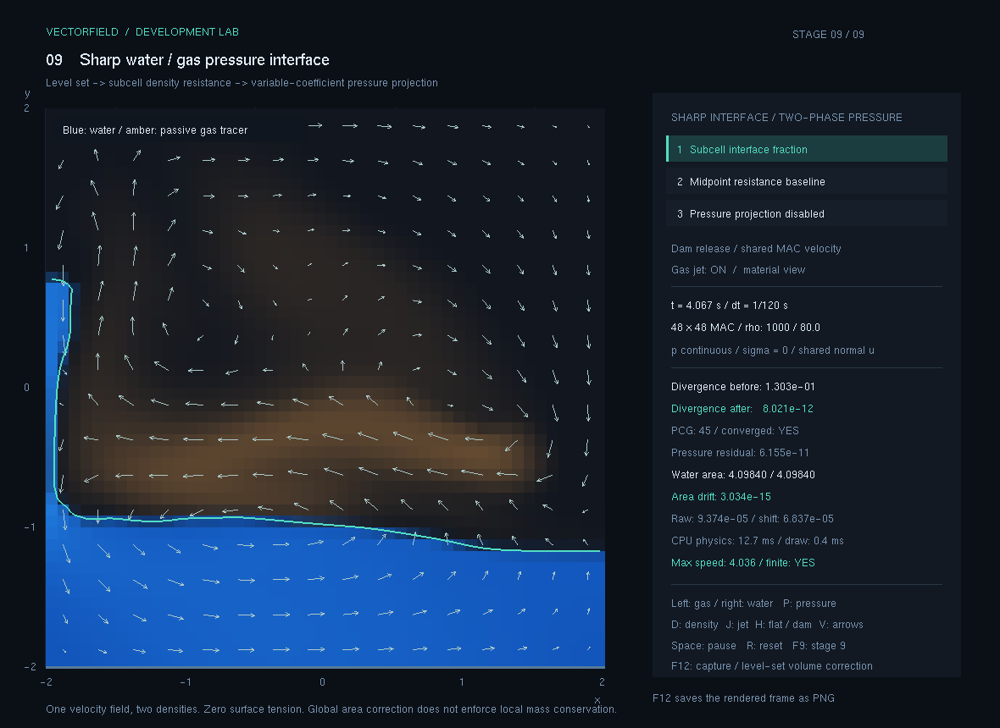
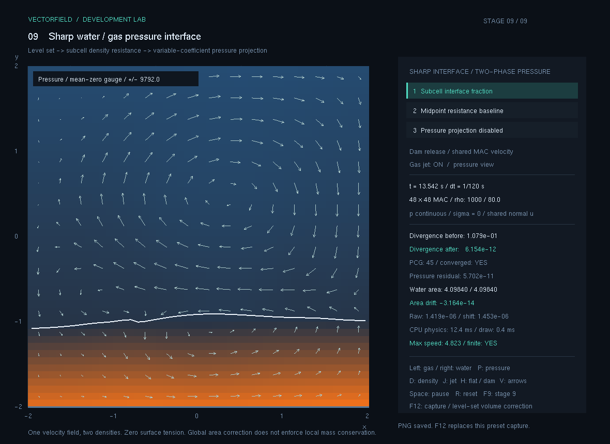

# 9단계 성능 최적화 기록

이 기록은 9단계 정밀 계면의 계산 비용과 실행 창의 멈춤을 줄이는 과정을 다룹니다. 같은 물리 조건에서 계산이 빨라졌는지와, 사용자의 입력에 더 자주 응답하는지를 따로 확인합니다.

현재 상태: **측정·구현·267개 공통 검사·70개 독립 검사·실제 캡처 2장 확인 완료 — 2026-11-09**. 같은 48² 계산 조건의 3회 중앙값에서 600스텝 계산 시간은 약 3배 빨라졌습니다. 화면 처리의 긴 콜백도 줄었으며, 대화형 물리 진행 속도와의 절충은 아래에 함께 기록합니다.

## 비교 기준

변경 전 기준은 Git 커밋 `75cf82b`입니다. 이 커밋의 계산 소스를 별도로 보관해 변경 후 코드와 같은 컴파일러·빌드 옵션·입력으로 비교합니다. 서로 다른 시점의 개발 로그에서 시간을 골라 개선율을 계산하지 않습니다.

| 조건 | 유지하는 값 또는 구분 |
| --- | --- |
| 빌드 | Visual Studio 2022, x64 Release, 같은 최적화 옵션 |
| 기본 격자 | 48×48 |
| 물리 시간 간격 | 고정 1/120초 |
| 내부 시간 분할 | 같은 CFL 기준과 분할 상한 |
| 압력 계산 | 같은 밀도·계면 계수·명시적 잔차 기준 |
| 기본 시나리오 | 같은 초기 물기둥, 기체 분출, 중력과 밀도 |
| 계산 시간 | 600회 고정 스텝, 물리 시간 5초의 `Step()` 경과 시간 합. 검증·로그 저장은 제외 |
| 반복 | 같은 조건을 반복하고 개별 측정값과 대표값을 함께 보관 |
| 화면 시간 | OpenGL 그리기와 이벤트 처리는 계산 전용 벤치마크와 별도 측정 |

`120Hz`는 물리 적분의 간격을 뜻합니다. 이 표기가 화면 120FPS나 실시간 속도 달성을 보장하지는 않습니다. 예를 들어 물리 시간 5초를 계산하는 데 실제 10초가 걸리면 계산 속도는 실시간의 0.5배입니다.

## 원인 가설과 확인 방법

| 코드에서 관찰한 구조 | 느려질 수 있는 이유 | 확인할 근거 |
| --- | --- | --- |
| 매 압력 투영의 임시 벡터 생성 | 내부 부단계마다 메모리를 할당·초기화하고 큰 배열을 여러 번 순회 | 압력 단계 시간, 작업공간 재사용 전후의 같은 입력 비교 |
| 면적 보정에서 40번 전체 격자 순회 | 대부분의 셀은 물 분율이 항상 0 또는 1인데도 삼각함수를 반복 계산 | 면적 보정 시간, 실제 계면 주변 셀 수와 처리 셀 수 |
| 대각 사전조건자의 PCG | 밀도 차이와 격자 이웃 결합 때문에 같은 잔차까지 많은 반복이 필요할 수 있음 | 반복 수와 압력 풀이 시간, 해·발산·에너지 검증 |
| 타이머의 누적 시간 처리 | 한 번의 이벤트에서 여러 물리 스텝을 처리하는 동안 입력과 그리기로 돌아오지 못함 | 이벤트별 처리 시간, 처리 스텝 수와 반환 정책 |
| 셀·선마다 별도 OpenGL 호출 | 작은 그리기 명령을 수천 번 전달하는 CPU 호출 비용 | 그리기 시간과 명령 묶음 변경 전후의 실제 화면 |
| HUD를 그릴 때 진단 재계산 | 화면 정보 표시만으로 면적·최대 속도·유한값 검사가 추가 순회를 만듦 | 진단 시간과 값 갱신 정책 |

이 표는 병목을 미리 단정한 목록이 아닙니다. 측정에서 차지하는 비중과 수정 위험을 함께 보고 적용 순서를 정합니다.

### 먼저 측정한 병목

기준 커밋의 계산에 구간별 타이머를 넣고, 48²·기체 밀도 80의 기본 장면을 600회 진행했습니다. 물리 시간 5초, 내부 부단계 1,101회에 실제 약 10.5903초가 걸렸습니다. 이 값은 구간별 계측을 넣은 한 번의 프로파일 실행이며, 뒤의 비계측 반복 벤치마크 대표 시간과 구분합니다.

| 계산 구간 | 측정 시간 | 전체 시간의 비중 |
| --- | ---: | ---: |
| 압력 투영 | 9,336.1942ms | 88.1578% |
| 거리장 재초기화 | 465.4933ms | 4.3955% |
| 속도 이류·외부 입력 | 223.9200ms | 2.1144% |
| 면적 보정 | 218.8277ms | 2.0663% |
| 계면 이류 | 160.6294ms | 1.5168% |
| 염료 수송 | 105.5512ms | 0.9967% |
| 이전 상태 배열 복사 | 31.6262ms | 0.2986% |
| 별도 면 계수 구성 | 27.8568ms | 0.2630% |

원자료는 [기준 프로파일 출력](기준프로파일.txt)과 [구간별 CSV](baseline_phase_profile.csv)에 있습니다. 압력 투영 구간에는 그 안에서 호출한 계수 구성·배열 작업과 반복 연산도 포함됩니다. 표의 구간 시간 합계와 전체 시간에는 구간 밖의 공통 처리 비용만큼 차이가 있습니다.

이 측정에서 가장 큰 비용은 압력 투영입니다. 면적 보정 구간의 비용만 완전히 없앤다고 가정해도 전체 시간 감소의 상한은 약 2.07%입니다. 따라서 면적·메모리 작업 개선은 불필요한 반복을 줄이는 보조 변경으로 보고, 큰 속도 개선은 압력 풀이가 같은 잔차에 더 적은 작업으로 도달하는지에서 판단합니다.

## 선택 기준과 개발 방식

우선 반복 계산을 줄여 같은 수식을 더 적은 작업으로 평가하는 방법을 검토합니다. 해상도나 시간 간격을 바꾸거나 압력 잔차 허용치를 느슨하게 하면 계산량이 줄 수 있지만, 같은 품질의 전후 비교가 되지 않습니다. 이번 비교에서는 이 설정들을 유지합니다.

면적 보정의 물 분율은 계면에서 충분히 먼 셀에서 정확히 0 또는 1입니다. 보정 이동량이 `[-0.5h, 0.5h]`로 제한될 때 `|phi| > 1.5h`인 셀은 보정 후보가 바뀌어도 분율이 변하지 않습니다. 따라서 이 상수 부분을 먼저 합산하고, 바뀔 수 있는 주변 셀만 같은 분율 식으로 평가합니다. 보정 식을 근사해서 속도를 얻는 것과 구분할 수 있는 근거입니다.

압력 계산은 반복 수 감소만으로 완료를 판단하지 않습니다. 새로운 사전조건자나 이전 해를 활용하는 방법을 적용한다면, 기존과 같은 압력 행렬에 대해 마지막에 `Aq-b`를 다시 계산해야 합니다. 계면 전달 조건·정수압·벽·발산과 질량 가중 운동 에너지도 다시 확인합니다.

### 계산 코어에서 채택한 변경

PCG, 이류와 거리장 재구성의 작업 배열은 격자 크기에 맞춰 한 번 확보하고 다시 사용합니다. 계산마다 필요한 값은 초기화하되 메모리 확보와 해제를 반복하지 않습니다. 이것은 할당 호출을 줄이는 변경입니다. 작업공간을 계속 유지하므로 상시 메모리는 늘며, 메모리 사용량을 줄였다고 설명하지 않습니다. 계면이 갱신된 뒤 압력 풀이 안팎에서 중복하던 면 계수 구성도 한 번으로 정리했습니다. 투영 해제 비교에서는 필요한 계수 갱신을 유지합니다.

면적 보정은 바뀔 수 있는 계면 주변 셀만 모아 계산하고, 항상 물인 셀의 기여는 상수로 합산합니다. 원래 분율 식, 목표 면적, 이동량 범위와 40회 이분법은 유지합니다. 합산 순서가 달라지는 만큼 마지막 자리의 반올림 차이는 전후 상태 대조로 확인합니다.

압력 사전조건자는 대각 Jacobi에서 **수정 불완전 Cholesky, MIC(0)**로 바꿨습니다. 압력 문제 `Aq=b` 자체를 바꾸는 것이 아니라, PCG가 잔차를 보정하는 보조 문제에 이웃 간 결합을 더 잘 반영하는 것입니다. MIC(0)는 원래 격자의 아래쪽·왼쪽 이웃에 해당하는 희소 구조만 유지한 인자 `L`을 만들고 다음 삼각 문제를 풉니다.

\[
M=LL^T,\qquad Ly=r,\qquad L^Tz=y.
\]

그 결과 `z`를 PCG의 탐색 방향 구성에 사용합니다. 대각값만 반영한 보조 문제보다 압력의 이웃 결합을 가까이 근사해 사전조건화된 문제의 조건을 개선하고, 같은 잔차까지 필요한 반복을 줄이는 것이 목적입니다. 모든 계면과 밀도에서 더 빠르다는 보장은 없으므로 실제 시간과 수렴을 함께 검사합니다. 이 접근과 수정 가중치 `tau=0.97`은 [Bridson·Müller-Fischer의 SIGGRAPH 2007 강의 노트 4.3절](https://www.cs.ubc.ca/~rbridson/fluidsimulation/fluids_notes.pdf)을 참고했습니다.

보조 인자의 대각 후보가 원래 대각의 0.25배보다 작으면 원래 대각을 사용해 작은 피벗을 피합니다. `0.97`의 수정 계수와 `0.25`의 최소 대각 비율은 [저자 공식 예제 소스](https://www.cs.ubc.ca/~rbridson/fluidsimulation/pcgsolver.tar.gz)의 기본값과도 같습니다. 이 안전 처리는 보조 인자에만 적용하며, 실제 압력 행렬 `A`에는 대각 보정항을 더하지 않습니다. 압력의 상수 자유도는 기존처럼 평균 0 부분공간에서 처리합니다.

격자 48², 기체 밀도 80에서 300고정스텝, 물리 시간 2.5초를 한 번씩 실행한 선택 실험은 다음과 같습니다. 이 표는 후보를 고르는 단일 실험이며 검증 배열 순회도 경과 시간에 포함됩니다. 아래의 반복 3회 공식 `Step()` 시간 합과 직접 비교하지 않습니다.

| 선택 실험 | 검증 순회를 포함한 실험 경과 시간 |
| --- | ---: |
| 기준 코드 | 5.4960793초 |
| 작업공간·계면 주변 면적 보정 | 5.3259559초 |
| 위 변경에 IC(0) 추가 | 2.8532673초 |
| 위 변경에 MIC(0) 추가 | 1.7912378초 |

작업공간·면적 변경만으로 줄어든 시간은 약 3.10%였습니다. 압력 계산이 전체의 약 88%라는 프로파일과, MIC(0)의 큰 반복 수 감소가 같은 방향을 가리켜 최종 후보로 채택했습니다. 마지막 내부 부단계에서 읽은 반복 수의 300스텝 합은 기준 85,248에서 MIC(0) 13,613으로 줄었습니다. 이는 모든 내부 부단계의 총 반복 수가 아닙니다. [선택 실험 출력](선택실험.txt)을 보관했고, 최종 채택은 성능뿐 아니라 아래의 수치 회귀 검사를 통과한 결과를 기준으로 합니다.

화면 반응성은 계산 시간과 별개로 다룹니다. 한 번의 타이머 콜백이 누적된 시간을 모두 따라잡으려 하면 느린 장면에서 입력 응답이 늦어질 수 있습니다. 콜백의 작업량을 제한할 경우에는 유지한 물리 시간 간격, 남겨 둔 계산량, 제외한 실제 경과 시간을 명확히 기록합니다. 고정 시간의 CLI 캡처에서는 물리 스텝을 생략해 목표 시각에 도달한 것처럼 표시하지 않습니다.

### 화면과 입력 처리에서 바꾼 점

대화형 실행의 누적 시간은 고정 스텝 4개분, 약 33.3ms로 제한했습니다. 최종 정책에서 한 타이머 콜백은 최대 세 고정 스텝을 진행하고, 첫 스텝 이후 누적 계산 시간이 12ms 이상이면 추가 스텝을 시작하지 않습니다. 사용자의 입력과 화면 그리기로 제어를 돌려줄 기회를 만드는 선택입니다. 이미 시작한 한 스텝은 중간에 끊지 않으므로, 이것이 모든 콜백을 12ms 안에 끝낸다는 보장은 아닙니다.

초기 후보는 최대 두 스텝·8ms였습니다. 같은 최적화 코어의 UI를 120프레임씩 3회 측정했을 때, 각 반복 p95의 중앙값은 타이머 약 `74.22 → 15.37ms`, 프레임 간격 약 `89.56 → 22.62ms`로 줄었습니다. 그러나 물리 시간/실제 경과 시간 비율의 중앙값도 약 `0.950 → 0.670`으로 낮아졌습니다. 더 자주 그리는 대신 시뮬레이션이 지나치게 느리게 진행되는 선택이어서, 세 스텝·12ms로 다시 조정해 최종 측정했습니다. 이 초기 후보 원자료는 [2스텝·8ms UI 측정](UI측정_2스텝8ms/summary.csv)에 남깁니다.

따라잡을 수 없는 실제 경과 시간은 별도 누적 카운터로 기록합니다. 물리 시간은 실제로 계산한 스텝 수만큼 증가합니다. 낮은 사양에서 시뮬레이션이 실시간보다 느리게 진행될 수 있지만, 계산하지 않은 시간을 진행한 것처럼 표시하지 않습니다. 목표 물리 시각을 지정한 캡처는 대화형 작업량 제한을 우회해 동일한 고정 스텝 순서를 끝까지 계산합니다. 0.1초를 넘는 벽시계 정체를 한 번에 받아들이지 않는 기존 상한은 유지하고, 이때 제외한 실제 시간도 기록합니다.

타이머의 다음 예약 시간은 직전 계산과 그리기에 든 시간을 반영합니다. 이전처럼 계산을 마친 뒤 매번 16ms를 추가로 쉬면 계산 시간이 그대로 프레임 간격에 더해집니다. 새 예약은 약 16ms의 기준 간격에서 이미 쓴 CPU 경과 시간을 빼되, 이벤트 처리를 위해 최소 1ms를 남깁니다. 이 방법도 운영체제·드라이버·버퍼 교환의 지연까지 정확히 제어하는 프레임 제한기는 아닙니다.

9단계의 셀 사각형, 속도 화살표, 계면 선은 각각 묶어 OpenGL에 전달합니다. 셀 위치·색상 식·계면 교차 계산은 유지하고, 셀이나 선마다 명령 묶음을 열고 닫는 호출을 줄였습니다. HUD의 물 면적과 상대 면적 오차는 같은 프레임에서 계산한 값을 공유합니다. 일시정지 중 입력도 다음 화면에 반영되도록 물리 시간만으로 여러 프레임의 값을 캐시하지 않습니다. 유한값 검사는 별도로 유지합니다.

성능 표시와 CSV의 `physics_cpu_ms`, `timer_cpu_ms`, `draw_cpu_ms`는 `steady_clock`으로 측정한 CPU 경과 시간입니다. 그리기에는 명령 전달과 버퍼 교환의 대기가 포함되며 GPU 연산 시간은 아닙니다. `frame_interval_ms`는 화면 그리기 시작 사이 간격이고, 입력 지연 시간을 직접 측정한 값은 아닙니다.

비교용 `--legacy-frame-loop`, `--legacy-grid-render`는 새 계산 코어 안에서 이전 스케줄링·그리기 방식을 선택합니다. 이를 변경 전 전체 프로그램과 같은 것으로 부르지 않고, UI 변경을 나눠 보는 대조군으로 사용합니다.

## 실제 측정 결과

계측하지 않은 기준 코어와 최적화 코어를 같은 실행 파일에 넣고, 기체 밀도 80과 1.2에서 각각 600고정스텝을 3회씩 진행했습니다. 총 12개 실행·7,200개 스텝의 원자료를 보관했습니다. 아래 전체 시간은 반복 3회의 `Step()` 시간 합 중 중앙값입니다.

| 기체 밀도 | 변경 전 | 변경 후 | 계산 속도 배수 | 시간 감소율 |
| --- | ---: | ---: | ---: | ---: |
| 80 | 10.7983838초 | 3.5476138초 | 3.04384배 | 67.1468% |
| 1.2 | 11.5558504초 | 3.8548138초 | 2.99777배 | 66.6419% |

아래 스텝 p50·p95는 각 반복에서 최근접 순위법으로 구한 값의 중앙값이고, 최댓값은 세 반복에서 관찰한 가장 긴 한 스텝입니다. 평균 처리량과 긴 멈춤을 구분하기 위해 함께 기록합니다.

| 밀도·버전 | 스텝 p50 | 스텝 p95 | 관찰 최대 스텝 |
| --- | ---: | ---: | ---: |
| 80·기준 | 18.6825ms | 28.4503ms | 54.2111ms |
| 80·최적화 | 6.0287ms | 9.3301ms | 16.6079ms |
| 1.2·기준 | 18.6674ms | 31.7517ms | 94.8777ms |
| 1.2·최적화 | 6.1302ms | 11.0850ms | 21.3840ms |

밀도 80의 내부 부단계 수는 전후 모두 1,101회, 밀도 1.2는 모두 1,182회였습니다. 적은 시간 단계로 계산을 덜 진행해서 얻은 차이가 아닙니다. 마지막 내부 부단계 PCG 반복 수의 고정스텝 합은 밀도 80에서 `170391 → 27064`, 밀도 1.2에서 `171507 → 27474`였습니다. MIC(0)는 한 반복의 보조 풀이 비용을 더 쓰지만, 필요한 반복 수를 줄여 전체 압력 시간을 줄이는 선택입니다.

환경과 방법은 [측정 환경](측정환경.txt), [벤치마크 설명·재실행 방법](벤치마크/README.md)에 있습니다. [스텝별 원자료](performance_steps.csv), [실행별 요약](performance_summary.csv), [실제 표준 출력](성능비교결과.txt)을 함께 보관했습니다. 프로파일용 타이머를 넣은 기준 실행과 이 공식 전후 비교는 서로 다른 실행입니다.

개선율은 같은 조건의 대표 시간으로 계산합니다.

\[
\text{속도 배수}=\frac{T_\mathrm{before}}{T_\mathrm{after}},\qquad
\text{시간 감소율}=\left(1-\frac{T_\mathrm{after}}{T_\mathrm{before}}\right)100\%.
\]

계산 전용 벤치마크의 처리량을 화면 FPS로 표기하지 않습니다. 평균이 빨라져도 긴 프레임이 남을 수 있으므로 중앙값과 상위 지연도 함께 확인합니다.

### 실제 UI에서 확인한 차이

최적화한 동일 계산 코어에서 이전 스케줄링·이전 그리기와 새 스케줄링·묶음 그리기를 비교했습니다. 기본 물기둥의 같은 초기 상태에서 각 120표시프레임을 3회 실행하고, 첫 20프레임을 제외한 100프레임으로 지연 분포를 구했습니다. 아래 p95는 각 실행 p95의 중앙값입니다. 물리 시간/실제 시간 비율과 제외한 시간 카운터는 예열을 포함한 전체 120프레임 구간에서 계산합니다.

| UI 지표 | 이전 UI 방식 | 최종 UI 방식 |
| --- | ---: | ---: |
| 타이머 콜백 CPU p95 | 75.9872ms | 18.8999ms |
| 그리기 시작 간격 p95 | 91.2406ms | 20.3740ms |
| 그리기 CPU p50의 중앙값 | 0.4041ms | 0.3594ms |
| 물리 시간/실제 시간 비율의 중앙값 | 0.9553 | 0.8121 |

한 번에 긴 계산을 몰아서 하던 콜백을 줄이고 더 자주 화면으로 돌아오는 효과를 확인했습니다. 다만 물리 시간 진행 속도는 대조 UI 방식의 약 0.96배 실시간에서 약 0.81배 실시간으로 낮아졌습니다. 초기 두 스텝·8ms 후보의 약 0.67배보다는 개선됐지만, 반응 기회와 계산 따라잡기 사이의 절충이 남습니다. 이 차이를 숨기고 모든 장면이 실시간이나 모든 입력의 지연이 특정 값 이하라고 설명하지 않습니다.

이 UI 비교는 같은 개수의 표시프레임을 모았으므로 종료 물리 시각은 서로 다릅니다. 같은 물리 양을 계산한 앞의 600스텝 벤치마크와 목적이 다르며, 원래 `75cf82b` 전체 실행 파일의 FPS 전후 비교도 아닙니다. 입력 이벤트를 주입한 시각과 반영 시각 사이의 지연 자체는 측정하지 않았습니다. 타이머 콜백 시간과 그리기 간격을 입력 지연으로 바꿔 부르지 않습니다.

묶음 그리기는 움직임이 거의 없는 정수압 압력 장면에서 따로 비교했습니다. 그리기 CPU p50의 3회 중앙값은 `0.3668 → 0.3424ms`였습니다. 약 0.0244ms의 작은 차이이므로 이 변경이 전체 계산 병목을 해결했다고 주장하지 않습니다. 주된 계산 개선은 MIC(0), UI에서 긴 콜백이 줄어든 주된 정책은 작업량 제한입니다.

원자료와 요약은 [최종 UI 측정](UI측정/summary.csv)에 있으며 각 실행의 프레임별 CSV도 같은 폴더에 있습니다. [UI 측정 스크립트](../../tools/Measure-UiPerformance.ps1)는 실행 순서를 번갈아 배치하고 같은 기준으로 요약합니다. 저장소 루트에서 다음처럼 다시 실행할 수 있습니다. 재실행하면 `UI측정/`에 새 결과를 씁니다.

~~~powershell
powershell.exe -NoProfile -ExecutionPolicy Bypass -File tools\Measure-UiPerformance.ps1 -Frames 120 -Repeats 3
~~~

## 검증과 한계

### 같은 계산을 유지했는지 확인

고정 계면의 같은 예측 속도를 각각 투영한 검사에서, 실제 MAC 면 속도의 최대 차이는 두 밀도 중 최대 `2.22257767746×10⁻¹⁰`, 평균 압력 기준을 제거한 압력 RMS 차이는 최대 `3.25119195388×10⁻⁷`이었습니다. 양쪽 모두 같은 명시적 잔차 기준에 수렴했습니다.

600스텝 뒤 실제 배열의 차이는 다음과 같습니다. 기준과 최적화가 비트 단위로 같다는 주장은 하지 않습니다.

| 최종 상태 차이 | 기체 밀도 80 | 기체 밀도 1.2 |
| --- | ---: | ---: |
| 레벨셋 RMS | `4.68176048158×10⁻⁶` | `8.01890047617×10⁻⁷` |
| 수평 MAC 면 속도 RMS | `1.66427961366×10⁻⁵` | `2.08105764123×10⁻⁶` |
| 수직 MAC 면 속도 RMS | `1.56341947961×10⁻⁵` | `1.44190641397×10⁻⁶` |
| 평균 기준을 제거한 압력 RMS | `0.0121595431334` | `0.00249019701676` |
| 보정 면적의 절대 차이 | `3.46389583683×10⁻¹⁴` | `2.6645352591×10⁻¹⁴` |

모두 측정 전에 정한 전후 대조 허용 범위를 충족했습니다. 레벨셋 RMS 허용치는 셀 크기의 0.1%, 속도·압력 RMS는 기준 RMS(최소 1)의 0.1%, 면적 절대 차이는 `1×10⁻⁸`입니다. 압력의 절대 차이와 상대 차이를 혼동하지 않도록 [전후 배열 차이 CSV](paired_state_differences.csv)에 둘 다 남겼습니다. 같은 버전·밀도의 반복 3회에서는 최종 배열 최대 차이가 0으로 재현됐습니다. 전체 성능·쌍별 상태 검사의 실패는 0개입니다.

최적화 코어를 사용해 다시 빌드한 별도 계면 검증기도 **70개 통과, 실패 0개**입니다. 48²의 기체 밀도 80·1.2 각각 600스텝에서 유한값·닫힌 벽·상 분율·마지막 내부 부단계의 압력 수렴을 유지했습니다. 최대 실제 발산 RMS는 각각 `3.52054517650×10⁻¹¹`, `3.77679709084×10⁻¹¹`입니다. 원문은 [독립 검증 결과](독립검증결과.txt)에 보관했습니다.

최종 x64 Release 공통 앱은 **267개 검사 통과, 실패 0개, 종료 코드 0**입니다. 기존 254개에 작업공간 초기화·큰 밀도비 회귀 2개, 프레임 스케줄러 11개를 더했습니다. 실제 출력은 [최적화 후 공통 검사](검증결과.txt)에 있습니다. 기존 단계 폴더의 최초 완성 로그와 이 최신 로그는 구분해 보존합니다.

프레임 스케줄러 검사는 누적 시간 상한·계산 예산·최대 스텝 수·분수 시간 누적·제외한 실제 시간과 초기화를 확인합니다. 캡처 모드가 대화형 제한을 우회해 12개 고정 스텝을 그대로 처리하는 조건도 검사했습니다.

실제 앱에서도 `--capture-after 0.5`를 새 UI 방식과 `--legacy-frame-loop --legacy-grid-render` 방식으로 각각 실행했습니다. 두 실행이 모두 물리 시간 0.500초에 도달했고 기록된 물리 진단 행이 같았으며 종료 코드는 0이었습니다. 이는 고정 스텝 캡처 경로와 기록 진단의 동등성을 확인한 결과이며, 이 시험만으로 모든 내부 배열의 비트 단위 동일성까지 주장하지 않습니다. [캡처 재현 검증](캡처재현검증.txt)에 실제 출력을 보관했습니다.

### 실제 창과 캡처

최적화 실행 파일을 실제 창에서 진행하고 F12를 눌러 PNG 저장 표시와 파일 생성을 확인했습니다. R로 기본 장면에 복귀한 직후 0.058초를, P로 압력 보기 전환을, Space로 13.558초의 일시정지와 유한값을 확인했습니다. 아래 두 PNG는 실제 OpenGL 프레임이며 각각 1180×860입니다. 원래 단계 기록 27장과 별도로 최적화 확인용 2장을 보관합니다.

4.067초의 재료 표시입니다. 압력 투영 전후 발산은 `0.13031418845 → 8.02074138857×10⁻¹²`, PCG는 45회이며 수렴 상태입니다. 화면의 물리 CPU 12.7ms는 직전 콜백이 처리한 물리 스텝들의 시간 합이고, 그리기 0.4ms는 직전 그리기의 명령 전달·버퍼 교환을 포함한 CPU 경과 시간입니다. 이 한 프레임의 숫자를 전체 벤치마크 대표값으로 사용하지 않습니다.

13.542초의 압력 표시입니다. 발산은 `0.1079273949 → 6.153942273×10⁻¹²`, PCG는 45회이며 유한값·수렴 상태를 확인했습니다. 물리 CPU 12.4ms, 그리기 0.4ms가 표시됩니다. 두 사진의 물리 시각이 다르므로 같은 상태의 재료/압력 대조 그림으로 해석하지 않습니다. 저장 당시 실제 수치는 [실제 캡처 기록](실제캡처기록.txt)에 있습니다.

같은 수학 문제를 풀어도 합산 순서나 사전조건자가 달라지면 부동소수점의 마지막 자리와 장시간 비선형 흐름의 상태가 달라질 수 있습니다. 즉시 적용한 한 연산의 오차와 5초 뒤 상태 차이를 같은 허용치로 판단하지 않습니다. 반대로 최종 그림이 비슷하다는 이유만으로 발산이나 압력 잔차 악화를 허용하지 않습니다.

성능 수치는 이 PC와 기록한 조건에서 얻은 결과입니다. 압력 풀이, 이류, 재초기화와 화면 갱신의 상대 비용은 해상도·밀도비·입력 강도·하드웨어에 따라 달라집니다. 최적화가 9단계의 모델 범위를 바꾸지는 않습니다. 표면장력 0의 비압축 두 재료 압력 조건과 레벨셋 전역 면적 보정의 한계는 기존 [계산과정](../계산과정.md)에 이어집니다.

최신 실행본은 [09_정밀계면.zip](../../배포/09_정밀계면.zip)에 반영했습니다. 보관 실행기에서 계면 42개와 스케줄러 11개 검사를 각각 통과했고, [실행기 로그](실행기검증.txt)와 [EXE 해시·배포 확인](배포확인.txt)에 결과를 남겼습니다.
