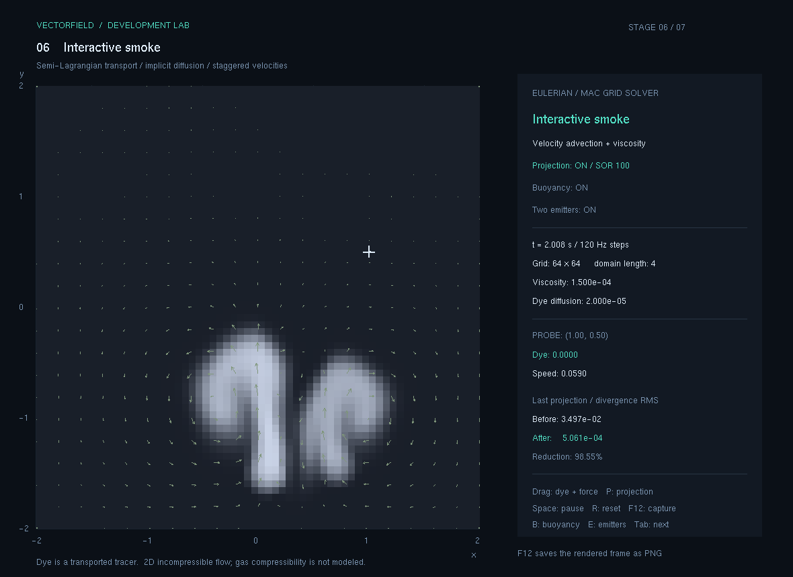
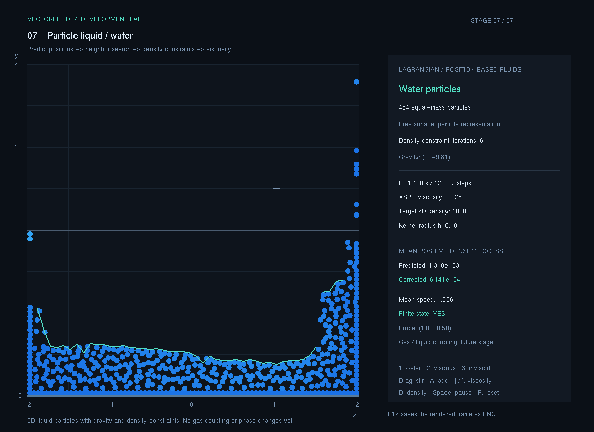
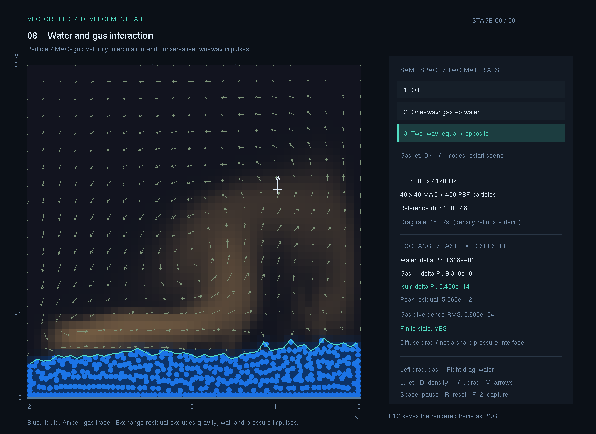
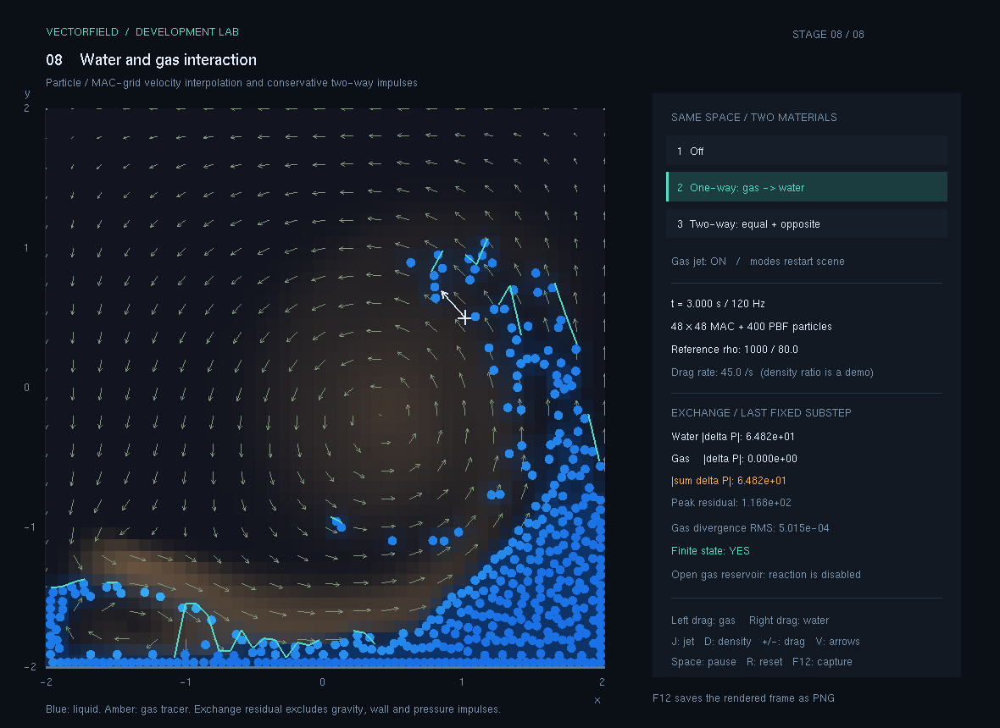

# VectorField

C++ / OpenGL로 벡터장부터 중력장, 입자 이류, 격자 유체와 물 입자, 같은 공간의 물·기체 결합까지 순서대로 구현한 프로젝트입니다. 1~8단계의 계산 코드·개발 설명·검증 출력·실행본과 실제 화면 PNG 22장을 번호 폴더에 보관합니다.

이 프로젝트는 **AI 코딩 에이전트 Codex를 활용해 개발**했습니다. 사용자는 “벡터장에서 출발해 물·기체 등 여러 재료가 상호작용하는 시뮬레이션으로 확장한다”는 목표와 단계별 기록·캡처·GitHub 보관 방식을 정했습니다. Codex는 기존 저장소를 살펴 실행 환경을 구성하고, 계산 모델 설계와 코드 구현, 검사 작성·실행, 실제 화면 확인, 개발 문서와 배포본 정리를 진행했습니다.

현재 공통 앱의 자동 수치 검사는 **214개 통과, 실패 0개**입니다. 8단계는 물과 기체가 같은 공간에서 항력 충격량을 주고받는 기초 결합을 구현했고, 해제·단방향·양방향 비교와 실제 PNG 저장을 마쳤습니다. 중력원 편집·기체 입력·물 젓기 등 기존 대표 조작과 단계별 수동 확인 범위는 [검증요약](검증요약.md)에 구분해 기록합니다. 정밀한 물·기체 압력 경계와 열·상변화는 다음 확장입니다.

## AI를 활용한 개발 방식

한 단계의 기능을 구현한 뒤 계산과 실행 결과를 확인하고 기록을 남기는 방식으로 진행했습니다. 앞 단계에서 만든 계산을 다음 단계에서 재사용하면서 비교할 수 있는 보관본도 함께 남겼습니다.

1. **기존 코드와 실행 환경 파악:** 원본 OpenGL 데모를 보존하고 Visual Studio 2022에서 빌드·실행할 수 있도록 `build.cmd`와 `run.cmd`를 준비했습니다.
2. **작은 계산부터 기능 확장:** 벡터의 성분·크기에서 시작해 중력 합성, 입자 적분, 격자 이류·확산, 압력 투영, PBF 물 입자, 물·기체 충격량 교환으로 확장했습니다. 각 단계에서 좌표·단위·시간 간격과 모델의 가정을 문서로 정했습니다.
3. **계산과 화면 분리:** 수학·물리 계산은 별도 헤더에, OpenGL 표시와 입력 처리는 `FieldLab.cpp`에 두었습니다. 화면을 띄우지 않고 계산 결과를 검사할 수 있게 구성했습니다.
4. **검사와 독립 검토:** 해석해·대칭·평형·벽 조건·발산·질량·운동량 등의 기준으로 자동 검사를 작성하고 실행했습니다. 8단계에서는 구현과 별도로 실제 속도 배열을 합산하는 검증기도 작성했습니다. AI 작업을 코어 구현·문서 작성·독립 검토로 나누어 검토 결과를 통합했습니다.
5. **실제 실행과 수정:** 프로그램을 빌드해 조작하고, 같은 초기 조건과 시간으로 비교 장면을 실행했습니다. PNG는 실제 OpenGL 프레임버퍼에서 저장했습니다. 직접 확인한 입력과 자동 재현한 입력은 검증 기록에서 구분합니다.
6. **결과 보관과 공개:** 단계마다 개발 과정·계산식·실제 검사 출력·캡처와 소스를 번호 폴더에 정리하고, 실행 파일·DLL을 포함한 ZIP을 만들었습니다. 검증한 결과를 Git 커밋으로 기록하고 GitHub에 보관합니다.

AI가 작성한 설명만으로 기능 완료를 판단하지 않고, 실행 로그·수치 비교·실제 화면을 함께 근거로 남겼습니다. 현재 검사 결과가 확인한 조건과 남은 모델의 한계는 아래와 각 단계 문서에서 확인할 수 있습니다.

## 개발 결과물

| 결과물 | 보관 위치와 내용 |
| --- | --- |
| 공통 시뮬레이션 앱 | [계산·화면 소스](opgnel_project_smoke/), `F1`~`F8`로 선택하는 8개 단계 |
| 단계별 개발 기록 | 아래 1~8단계 폴더의 `README.md`, `계산과정.md`, `검증결과.txt` |
| 실제 실행 화면 | 단계별 `캡처/`의 PNG **총 22장**, 각 README에 비교 조건과 이미지 수록 |
| 실행·소스 보관본 | 단계별 `실행.cmd`, `실행파일/`, `소스/`와 [배포 ZIP 8개](배포/) |
| 검증 코드와 결과 | [공통 자동 검사](tests/) **214개 통과**, [8단계 별도 검증기](8.다중재료상호작용/검증/README.md)의 64개 조건 검사 |
| 전체 진행과 검증 범위 | [단계별 개발계획](단계별_개발계획.md), [검증요약](검증요약.md) |

## 단계별 결과

| 단계 | 핵심 계산 | 계산·검증 기록 | 실행·배포 | 상태 |
| --- | --- | --- | --- | --- |
| [1.벡터장](1.벡터장/README.md) | 4종 벡터장, 크기·정규화, 중앙차분 발산·회전 | [계산](1.벡터장/계산과정.md) · [검증](1.벡터장/검증결과.txt) | [실행](1.벡터장/실행.cmd) · [ZIP](배포/01_벡터장.zip) | 완료 · PNG 4장 |
| [2.중력장](2.중력장/README.md) | 완화한 역제곱 가속도, 중력원 벡터 합 | [계산](2.중력장/계산과정.md) · [검증](2.중력장/검증결과.txt) | [실행](2.중력장/실행.cmd) · [ZIP](배포/02_중력장.zip) | 완료 · PNG 2장 |
| [3.입자이동](3.입자이동/README.md) | 중점 RK2, 고정 시간 간격, 추적 입자 궤적 | [계산](3.입자이동/계산과정.md) · [검증](3.입자이동/검증결과.txt) | [실행](3.입자이동/실행.cmd) · [ZIP](배포/03_입자이동.zip) | 완료 · PNG 2장 |
| [4.이류와확산](4.이류와확산/README.md) | 역추적 이류, 쌍선형 보간, 암시적 확산 | [계산](4.이류와확산/계산과정.md) · [검증](4.이류와확산/검증결과.txt) | [실행](4.이류와확산/실행.cmd) · [ZIP](배포/04_이류와확산.zip) | 완료 · PNG 2장 |
| [5.비압축유체](5.비압축유체/README.md) | MAC 속도 격자, 압력 포아송 해법, 발산 투영 | [계산](5.비압축유체/계산과정.md) · [검증](5.비압축유체/검증결과.txt) | [실행](5.비압축유체/실행.cmd) · [ZIP](배포/05_비압축유체.zip) | 완료 · PNG 2장 |
| [6.상호작용기체](6.상호작용기체/README.md) | 두 노즐의 연기 주입, 농도 기반 부력, 입력 속도 증분 | [계산](6.상호작용기체/계산과정.md) · [검증](6.상호작용기체/검증결과.txt) | [실행](6.상호작용기체/실행.cmd) · [ZIP](배포/06_상호작용기체.zip) | 완료 · PNG 2장 |
| [7.물입자](7.물입자/README.md) | 2D PBF 밀도 제약, 위치 보정, XSPH 점성, 벽·젓기 | [계산](7.물입자/계산과정.md) · [검증](7.물입자/검증결과.txt) | [실행](7.물입자/실행.cmd) · [ZIP](배포/07_물입자.zip) | 완료 · PNG 4장 |
| [8.다중재료상호작용](8.다중재료상호작용/README.md) | 공유 공간의 항력·충격량 교환, MAC 보간과 반작용, 결합 비교 | [계산](8.다중재료상호작용/계산과정.md) · [검증](8.다중재료상호작용/검증결과.txt) · [독립 검증](8.다중재료상호작용/독립검증결과.txt) | [실행](8.다중재료상호작용/실행.cmd) · [ZIP](배포/08_다중재료상호작용.zip) | 기초 결합 완료 · PNG 4장 |

각 단계 README에서 기능·개발 순서·조작법과 캡처 조건을 확인할 수 있습니다. [단계별 개발계획](단계별_개발계획.md)에는 완료 기준, 실측값과 정밀 계면·열·3D 확장을 정리했습니다.

| 6단계: 2D 비압축 연기 | 7단계: 2D 물 입자 |
| --- | --- |
| [](6.상호작용기체/캡처/01_연기분출.png) | [](7.물입자/캡처/02_자유표면.png) |

두 이미지는 각 매체를 따로 계산하는 6·7단계의 실제 OpenGL 실행 프레임입니다. 6단계는 염료를 운반하는 비압축 연기 모델이고, 7단계는 입자 밀도 제약으로 물의 압축을 줄이는 PBF 모델입니다. 이 기초 모드를 보존하고 8단계에서 두 솔버를 연결했습니다.

| 8단계: 물·기체 양방향 결합 | 같은 초기 조건의 단방향 결합 |
| --- | --- |
| [](8.다중재료상호작용/캡처/01_양방향.png) | [](8.다중재료상호작용/캡처/02_단방향.png) |

8단계는 **확산 경계의 항력·운동량 교환 근사**입니다. 양방향 모드의 교환 연산은 실제 물 입자와 기체 MAC 면 속도의 전후 값을 합산해 운동량 잔차와 에너지 비증가를 확인했습니다. 기체 격자는 물 내부에도 이어지는 고정 질량의 계산 매체이며, 점유도에 따른 연기 농도 제외는 추적량 표시 처리입니다. 정밀한 불침투 압력 경계나 두 상의 질량·부피 배제를 구현한 모델로 해석하지 않습니다. 기본 물/기체 기준 밀도 1000/80은 반응을 관찰하기 위한 교육용 밀도비 12.5이며, `D`로 기체 기준 밀도 1.2와 비교할 수 있습니다. 열전달·상변화와 압축성 기체 상태방정식은 아직 계산하지 않습니다.

## 실행

`run.cmd`를 더블 클릭하세요. 기본 실행 파일은 `x64\Release\opgnel_project_smoke.exe`입니다. 실행 파일이 없으면 먼저 빌드합니다.

기본 실행은 1단계 벡터장입니다. `F1`~`F8` 또는 `Tab`으로 단계를 선택하고, `Space`로 일시정지·재개, `R`로 초기화, `F12`로 PNG 저장을 합니다. 단계별 입력은 각 README의 조작표를 따릅니다. 1단계에서는 `1`~`4`로 장 선택, `+`/`-`로 강도, `G`로 격자 수, `N`으로 화살표 길이 정규화를 조절합니다.

~~~powershell
.\run.cmd --stage 6
.\run.cmd --stage 7
.\run.cmd --stage 8
~~~

8단계에서 `1`·`2`·`3`은 각각 결합 해제·단방향·양방향 장면을 같은 초기 조건으로 재시작합니다. `J`는 분출원, `D`는 기체 밀도 비교와 재시작, `+`/`-`는 항력률, `V`는 속도 화살표입니다. 왼쪽 드래그로 기체에 입력하고 오른쪽 드래그로 물을 젓습니다.

번호 폴더의 `실행.cmd`는 그 단계의 보관본을 엽니다. GitHub에서 소스만 복제해 보관 EXE가 없으면 상위 공통 실행기를 통해 빌드·실행합니다. 다른 PC로 옮길 때는 `배포` 폴더의 해당 ZIP 전체를 풀어 실행합니다. 실행 파일과 `freeglut.dll`을 함께 두어야 합니다. 2~8단계의 `소스/전체소스.zip`에는 다시 빌드할 소스 묶음이 있고, 1단계는 `소스/` 아래에 직접 보관합니다.

원래 저장소의 `Smoke` 데모는 `.\run.cmd --legacy`로 열 수 있습니다. 비교용 원본 경로이며, 2단계의 새 중력 계산은 별도 `DynamicsMath.h`에 있습니다.

## 빌드

다음 도구가 필요합니다.

- Git for Windows
- Visual Studio 2022의 **C++를 사용한 데스크톱 개발** 워크로드
- MSVC v143, Windows 10 또는 11 SDK, **Windows용 C++ CMake 도구** 구성 요소

프로젝트 폴더에서 실행하세요.

```powershell
.\build.cmd
.\run.cmd
```

`build.cmd`는 Visual Studio 설치 위치를 자동으로 찾고, 공식 freeglut 3.6.0을 `.deps` 폴더에 내려받아 빌드한 뒤 앱을 빌드합니다. 최초 빌드에는 인터넷 연결이 필요합니다. freeglut 소스는 커밋 `566cd459201ae29003ef5686c06506d8646e55c6`으로 고정되어 있습니다.

기본 구성은 `Release / x64`입니다. 다른 구성은 다음처럼 지정합니다.

```powershell
.\build.cmd -Configuration Debug
.\build.cmd -Platform Win32
```

x64 실행 파일은 `x64\Release` 또는 `x64\Debug`에, Win32 실행 파일은 `Release` 또는 `Debug`에 생성됩니다. 필요한 `freeglut.dll`은 실행 파일 옆에 자동 복사됩니다. `run.cmd`는 기본 `Release / x64` 실행 파일을 실행합니다.

## Visual Studio 2022에서 열기

먼저 사용할 플랫폼으로 `build.cmd`를 한 번 실행해 freeglut를 준비한 뒤 `opgnel_project_smoke.sln`을 여세요. 구성은 `Release` 또는 `Debug`, 솔루션 플랫폼은 `x64` 또는 `x86`을 선택하고 빌드·실행하면 됩니다. 솔루션의 `x86`은 프로젝트의 `Win32`에 대응합니다.

현재 진입점과 화면은 [FieldLab.cpp](opgnel_project_smoke/FieldLab.cpp)입니다. 계산은 [FieldMath.h](opgnel_project_smoke/FieldMath.h), [DynamicsMath.h](opgnel_project_smoke/DynamicsMath.h), [FluidGrid.h](opgnel_project_smoke/FluidGrid.h), [WaterParticles.h](opgnel_project_smoke/WaterParticles.h), [TwoMaterialSimulation.h](opgnel_project_smoke/TwoMaterialSimulation.h)에 나눴습니다. 원래 `source.cpp`는 `LegacyMain()`으로 보존했습니다.

## 수치 검증과 기록

~~~powershell
.\x64\Release\opgnel_project_smoke.exe --self-test
~~~

공통 앱은 검사를 순서대로 실행합니다. FieldMath 69개, Dynamics 42개, FluidGrid 21개, WaterParticles 41개와 TwoMaterial 41개를 합쳐 **214개 모두 통과**했습니다. 2·3단계는 Dynamics 검사를 공유하고, 4~6단계는 FluidGrid 검사를 공유하므로 각 폴더의 출력을 중복해서 더하지 않습니다. 1~7단계의 당시 173개 기록은 그대로 보관하고, 신규 결합 검사까지 포함한 전체 출력은 [8단계 검증결과](8.다중재료상호작용/검증결과.txt)에 남겼습니다.

별도의 [독립 검증기](8.다중재료상호작용/검증/README.md)는 64개 임의·벽·모서리 상태에서 실제 속도를 다시 합산했습니다. 교환 연산의 최대 상대 운동량 잔차는 약1.46×10⁻¹⁵, 에너지 증가의 양수 부분은 0이었습니다. 기본 48×48 격자의 600스텝 전체 진행에서도 유한값·벽 조건·물 입자 질량이 유지됐습니다. 중력·분출원·압력 투영·물의 벽 보정을 포함한 전체 장면까지 운동량이 일정하다는 주장은 하지 않습니다.

검증에는 회전 궤도의 해석해 비교, 균일 흐름의 염료 이동량, 압력 투영 전후 발산, 물의 밀도 초과량·벽 조건·입자 수 유지가 포함됩니다. 수치와 조건은 [개발계획의 실측 기록](단계별_개발계획.md#실측으로-확인한-계산)에 정리했습니다. 예제 범위의 검사 통과가 모든 재료와 입력에서의 정확성을 보장하지는 않습니다.

완성된 코드·개발 기록·실제 캡처와 배포 ZIP은 [main 브랜치](https://github.com/chickenbuger/VectorField/tree/main)에서 확인할 수 있습니다. 각 단계가 추가된 과정은 저장소의 커밋 기록에 남깁니다.
